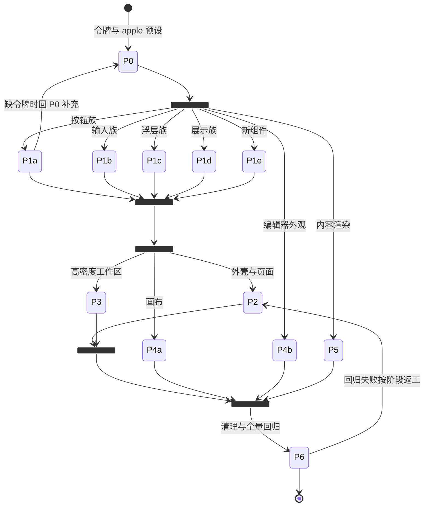

# Apple 风格 UI 全量改造计划

> 日期：2026-11-05
> 样式规范：`docs/design/ui-style-guide.md`（下称“规范”，引用写作“规范 §N”）
> 参考实现：`/Users/andyzheng/git/ai-coding-project/platform`（只读，不复制代码）
> 状态：P0–P5 的本轮代码实现、P6 守卫与本机回归已交付；2026-11-06 最终源码为 `909132f5`。完整跨平台、真实后端交互及逐业务弹窗视觉矩阵仍未验收，因此不标为“全计划验收完成”。本轮实际结果、兼容性取舍和遗留边界见第 10 节。

## 1. 目标与已确认的决定

把 BeeCode 前端统一成参考平台的 Apple 风格（系统蓝、毛玻璃浮层、胶囊按钮、大圆角卡片、克制阴影、短促缓动），并沿用它的交互习惯。改造期间所有现有功能必须照常可用。

用户已确认：

1. **新增 `apple` 主题预设并设为默认**。只影响没有保存过主题色的用户；已保存主题的用户保持原样，12 套旧预设全部保留可选。
2. **深色按同一规范推导**，不回退到 neutral.dark。
3. **全量改造**：页面级界面按参考平台重排；会话区、终端等高密度区域使用规范 §5 推导出的“紧凑密度”。Markdown 渲染里的流程图（Mermaid）、代码块、表格一并改造。

## 2. 硬约束（每个阶段都适用）

- **不改行为**：不改组件 props 签名、事件、数据流、路由、i18n 键名、`data-slot`、`data-testid`、`aria-*`、`role`。需要新外观时加 variant 或新组件，不删旧 variant。
- **不碰浮层机制**：`OverlayPortalContainerProvider`、`useNestedLayerDismissGuard`、`acquireNativeSurfaceOcclusion*`、`overlay-host-hidden`、drawer 的嵌套层逻辑只能改 className。
- **不破坏背景图功能**：`ws-surface*`、`ws-msg-*`、`ws-chrome-border`、`ws-strip-line`、`ws-transparent-bg`、`ws-no-fade` 的开图规则保持有效；改造后的组件继续挂这些类。
- **缩放与 RTL**：字号用 rem（规范 §4），方向用逻辑属性；`:root` 的 `line-height: 1.5em` 不动（`globals-root-units.test.ts` 守着）。
- **性能**：虚拟列表、消息流、编辑器、终端内部不加 `backdrop-filter`，不给虚拟列表行加进入动画。
- **测试**：现有 46 个文件用 `toHaveClass` 断言类名。只有断言的是“纯视觉类”且改动符合规范时才更新断言，并在提交说明里逐条列出；断言行为类（`hidden`、`sr-only`、`pointer-events-none`、`data-*` 状态、`inert`）的测试不许为了通过而修改。
- **文案**：新增可见文案补齐 10 种语言（`src/i18n/messages/*.json`），`messages.test.ts` 必须通过。

## 3. 工程流程

- 每个阶段（或阶段内每个可独立交付的工作包）一个独立 worktree：`worktrees/wt_ui-<阶段>_<ID>`，从最新目标分支创建；不在原工作区写入。
- 阶段内可并行的工作包写入范围不重叠（见第 5 节表格的“写入范围”）。共享文件 `src/app/globals.css`、`src/components/ui/*` 只由 P0、P1 修改，后续阶段如需新令牌，回到 P0 的负责人补充，避免多处同时改全局文件。
- 每个工作包完成后：`pnpm lint .`、`pnpm test`（至少相关目录，阶段收尾跑全量）、`pnpm build`，并按第 7 节做视觉验收，再提交到任务分支，由合并者合回目标分支。
- 每个阶段合回后都应是可发布状态。任何阶段都能单独回滚（`git revert` 该阶段的合并提交）。

## 4. 现状摘要（2026-11-05 基线 `24477349`）

| 项 | 现状 | 对改造的影响 |
| --- | --- | --- |
| 主题 | 12 套预设，变量写在 `globals.css` 的 `[data-theme]` 中；`theme-presets.ts`、`appearance-script.ts`（`VALID_COLORS` 白名单）、`appearance-provider.tsx`、`monaco-themes.ts`、`canvas-swatches.tsx` 都依赖预设列表 | 新预设要同步 6 处 + i18n + 对账测试 |
| 默认主题 | `DEFAULT_THEME_COLOR = "neutral"`；localStorage 只在用户选择后写入 | 改默认值即可实现“新用户默认 apple、老用户不变” |
| 默认字体 | `DEFAULT_UI_FONT_ID = "inter"`，`globals.css` 首屏兜底栈必须与它一致 | 改为 `system-ui` 时两处同步，否则首屏闪字 |
| UI 基元 | shadcn radix-maia，45 个文件；18 个文件用 `rounded-4xl`（输入框、选择器、按钮组也是胶囊） | P1 统一改 |
| 使用面 | `Button` 被 200 个文件引用，`Dialog` 73、`AlertDialog` 40、sonner toast 127 | 基元改样式即可覆盖大部分界面 |
| 硬编码 | 8 个 tsx 含十六进制颜色，14 个含 `bg-black/`、`bg-white/`、`text-white`，11 个含 `text-[Npx]` | P6 清理 |
| 页面 | 23 个设置子页、工作区（`workspace/layout.tsx` 1606 行）、登录、提交、合并、推送、贮藏、导入会话、项目启动、桌宠、电脑操作指示 | 分阶段改 |
| 内容渲染 | Streamdown 2.7 + shiki + `@streamdown/mermaid`（自定义 `mermaid-theme.ts`，固定蓝灰调色板） | P5 改为跟随主题 |
| 画布 | `@xyflow/react`，`components/canvas/` 19 个文件 | P4 |

## 5. 阶段与工作包

### P0 设计令牌与 apple 预设（基础，必须先完成）

**目标**：令牌就位，切到 apple 预设后全局配色正确，其他预设零视觉变化。

**写入范围**：`src/app/globals.css`、`src/lib/theme-presets.ts`、`src/lib/appearance-script.ts`、`src/components/appearance-provider.tsx`（仅预设列表相关处）、`src/lib/monaco-themes.ts`、`src/lib/font-presets.ts`、`src/components/canvas/canvas-swatches.tsx`（如需）、`src/i18n/messages/*.json`（`themeColor.options.apple`）、相关测试。

**任务**：

1. `THEME_COLORS` 加 `"apple"`（放第一位，作为推荐项展示），补 `THEME_COLOR_PREVIEW`、`THEME_COLOR_TITLE`（规范 §2.1 最后两行）。
2. `globals.css` 新增 `[data-theme="apple"]` 与 `[data-theme="apple"].dark` 两段，值取规范 §2.1；在 `--activity-accent` 那段补 apple 两行。
3. 新增全局令牌（规范 §2.2）、`--ease-apple`、动效工具类 `anim-fade` / `anim-pop` / `anim-slide` / `anim-fade-up`（规范 §7）、玻璃工具类 `surface-glass` / `surface-glass-strong` 及其降级（规范 §2.4）、应用背景 `app-backdrop`、字号工具类 `text-ui`、`text-heading-sm`、`text-heading`、`text-page-title`、`text-display`（规范 §4），并在 `@theme inline` 注册颜色与阴影。
4. `appearance-script.ts` 的 `VALID_COLORS` 加 `apple`，回退值改为 `apple`；`DEFAULT_THEME_COLOR` 改为 `"apple"`。两处必须一致（文件内注释已说明要同步）。
5. 默认字体改为 `system-ui`：`DEFAULT_UI_FONT_ID` 与 `globals.css` `:root` 的 `--font-sans` 兜底栈同步修改，并更新相关注释与测试。已保存字体的用户不受影响。
6. `monaco-themes.ts` 画布底色表和当前行高亮表补 `apple`（规范 §11）。
7. i18n：10 个语言文件补 `themeColor.options.apple`（中文“苹果蓝”，英文“Apple”，其余按语言翻译）。
8. 测试：`globals-activity-accent.test.ts` 会自动覆盖 apple；补一条断言 `VALID_COLORS` 与 `THEME_COLORS` 一致；`monaco-themes.test.ts` 覆盖 apple；新增一个对比度测试，解析 `globals.css` 中 apple 明暗两段，断言规范 §13 的关键组合（前景/背景、muted-foreground/muted、primary-foreground/primary、destructive/background）达到 4.5:1。

**验收**：

- 清空 localStorage 首次启动为 apple 浅色；切到深色正确；切回 neutral 等 12 套预设与基线截图一致。
- 已存 `theme-color=violet` 的用户启动后仍是 violet。
- 自定义样式（`custom-style-section.tsx`）覆盖主色和圆角在 apple 预设下生效。
- 首屏无闪色、无闪字（桌面和服务器模式各冷启动一次）。

### P1 基础组件（依赖 P0）

**目标**：`src/components/ui/*` 全部符合规范 §8，从而覆盖约 70% 的界面。

工作包可并行（写入文件互不重叠）：

| 包 | 文件 | 规范 |
| --- | --- | --- |
| P1-a 按钮族 | `button.tsx`、`button-group.tsx` | §8.1、§8.2 |
| P1-b 输入族 | `input.tsx`、`textarea.tsx`、`input-group.tsx`、`search-input.tsx`、`search-clear-button.tsx`、`select.tsx`、`combobox.tsx`、`field.tsx`、`label.tsx`、`checkbox.tsx`、`radio-group.tsx`、`switch.tsx`、`slider.tsx`、`calendar.tsx` | §8.3、§8.4、§8.12 |
| P1-c 浮层族 | `dialog.tsx`、`alert-dialog.tsx`、`drawer.tsx`、`popover.tsx`、`hover-card.tsx`、`tooltip.tsx`、`dropdown-menu.tsx`、`context-menu.tsx`、`command.tsx`、`image-preview-dialog.tsx` | §8.8、§8.9、§8.10 |
| P1-d 展示族 | `card.tsx`、`badge.tsx`、`tabs.tsx`、`progress.tsx`、`skeleton.tsx`、`avatar.tsx`、`pagination.tsx`、`separator.tsx`、`scroll-area.tsx`、`folder-badge.tsx`、`chart.tsx`、`app-toaster.tsx` | §8.5、§8.6、§8.7、§8.13、§8.15 |
| P1-e 新组件 | 新增 `segmented.tsx`、`page-header.tsx`、`empty-state.tsx`、`stat-card.tsx`、`data-table.tsx`（只做样式外壳：表头吸顶、单行截断、空行、分页条） | §8.7、§8.11、§8.14、§8.16 |

要点：

- 按钮的 `active:not-aria-[haspopup]:translate-y-px` 换成 `active:scale-[0.97]`，保留 `aria-[haspopup]` 例外。
- 输入类从 `rounded-4xl` 改为 `rounded-lg`；按钮保持胶囊。
- 菜单/选择器高亮项改实心主色（规范 §8.3、§8.10），检查所有预设下高亮文字对比度。
- `dialog.tsx` 的 `bg-black/80` 遮罩、`duration-100` 改为规范值；`max-w-md` 默认宽改为 560px 时，**检查所有调用处是否显式传了宽度**，避免撑宽已经调好的对话框（73 个引用，列出未传宽度的调用并逐个看截图）。
- Toast 只改 sonner 的 `toastOptions.classNames` 和 `AppToaster` 包装，不改调用处。

**验收**：`pnpm test` 中 `components/ui` 下全部测试通过（含 drawer 嵌套层、遮挡、嵌套关闭测试）；做一个仅开发环境可见的组件陈列页（见第 7 节）并截图；抽查 10 个使用面最大的对话框、菜单。

### P2 应用外壳与页面级界面（依赖 P1；包之间可并行）

| 包 | 写入范围 | 内容 |
| --- | --- | --- |
| P2-a 工作区外壳 | `src/app/workspace/layout.tsx`、`components/layout/` 中的 `sidebar.tsx`、`app-title-bar.tsx`、`folder-title-bar.tsx`、`left-edge-chrome.tsx`、`right-edge-chrome.tsx`、`chrome-reserve.tsx`、`status-bar*.tsx`、`aux-panel-tab-rail.tsx`、`window-controls.tsx`、`mobile-workspace-panes.tsx`、`workspace-degraded-banner.tsx` | 应用背景、浮动玻璃侧栏（规范 §9 第一条，几何冲突时保留贴边）、标签条、状态栏、主导航激活态 |
| P2-b 设置页 | `components/settings/settings-shell.tsx`、`components/shared/settings-section.tsx`、`setting-card.tsx`，以及 `components/settings/*` 中的页面级布局 | 左侧导航用侧栏导航样式；右侧 `PageHeader` + 卡片分组；表单按规范 §8.4；列表改用 `DataTable` 外壳 |
| P2-c 独立页面 | `src/app/login/page.tsx`、`commit`、`merge`、`push`、`stash`、`import-sessions`、`project-boot`、`computer-indicator`、`computer-marker`、`src/app/page.tsx` 首屏加载、`components/layout/app-boot-loading.tsx` | 登录页按参考平台：左侧品牌主视觉（大屏显示），右侧玻璃登录卡片；手写的 input/button 换成 UI 基元；其余页面套 `app-backdrop` + 卡片 |
| P2-d 错误与空状态 | 连接失败、403/404 类页面、`aux-panel-no-folder-empty.tsx` 及各处空列表 | 规范 §8.14 |

要点：

- `workspace/layout.tsx` 很大且有大量源码级测试（`*-source.test.ts`）断言结构，只改 className，不挪动 JSX 结构；浮动侧栏若需要外层留白，加在最外层容器的 padding 上，并核对 `chrome-reserve`、`window-resize-grips`、Tauri 拖拽区（`data-tauri-drag-region`）的命中区域。
- 登录页文案全部已有 i18n 键，新增的品牌介绍文案补 10 种语言。
- macOS 红绿灯、Windows 窗口按钮、Linux 无边框窗口三种标题栏都要截图核对。

### P3 工作区高密度区域（依赖 P1；与 P2 可并行，但 P2-a 合回后再做最终视觉验收）

| 包 | 写入范围 | 内容 |
| --- | --- | --- |
| P3-a 会话列表与侧栏行 | `components/conversations/*`、`components/layout/session-directory*`、`branch-*`、`command-dropdown.tsx`、`quick-actions-dropdown.tsx`、`new-folder-dropdown.tsx`、`open-in-menu.tsx`、`row-more-button.tsx` | 紧凑行 32px、`rounded-md`、选中 `bg-primary-soft`（规范 §9 紧凑列表选中态）；吸顶分组标题保留现有几何（参见 `2026-10-14-sticky-top-sections.md`） |
| P3-b 辅助面板 | `components/layout/aux-panel*.tsx`、`git-log-*`、`file-tree-*`、`components/files/*`、`components/diff/*`、`components/forge/*` | 紧凑密度；Git 图、文件树行高不变 |
| P3-c 会话输入区 | `components/chat/*` | 输入卡片 `rounded-2xl` 玻璃卡（不在消息流内，可用玻璃）、工具条图标按钮 28px、模式/模型选择器用规范菜单 |
| P3-d 消息流 | `components/message/*`（不含 Markdown 渲染内核）、`components/ai-elements/*` 中非 Mermaid 部分 | 用户气泡、元信息、执行过程胶囊和详情框（规范 §10）；不改 `--activity-*` 几何与时间线 CSS 的位置计算 |
| P3-e 终端与浏览器 | `components/terminal/*`、`src/lib/terminal/theme.ts`、`components/browser/*`、`components/tabs/*` | 终端光标与选区跟随主色（规范 §11），ANSI 色不动；浏览器面板工具条和标签条 |
| P3-f 任务、自动化、工作台 | `components/tasks/*`、`components/automations/*`、`components/workbench/*`、`components/token-usage/*`、`components/assistants/*`、`components/computer/*` | 看板列 `rounded-2xl` 玻璃卡（参考平台看板）、任务卡、详情抽屉（规范 §8.9）、统计卡 |

要点：

- 消息流里的样式改动必须同时检查 `data-workspace-bg="on"` 下的效果。
- 虚拟列表行高不能变，否则滚动定位和吸顶计算会出错；需要改行高的地方先改测量常量和对应测试，并单独提交。
- 会话区动画遵守 `data-chat-animations="off"`。

### P4 画布与编辑器（依赖 P0、P1）

| 包 | 写入范围 | 内容 |
| --- | --- | --- |
| P4-a 无限画布 | `components/canvas/*` | 节点卡片、选中环、连线颜色、图例、缩放控件（规范 §11） |
| P4-b 编辑器外观 | `src/lib/monaco-themes.ts`（P0 已补底色，此处补选区/光标随主色）、编辑器外围工具条 | 规范 §11 |

### P5 内容渲染（依赖 P0；与 P3-d 写入范围分开）

**写入范围**：`components/ai-elements/mermaid-theme.ts`、`mermaid-block.tsx`、`mermaid-view.ts`、`globals.css` 中 Streamdown 相关段落（由 P0 负责人合入或在本包内修改并与 P0 串行）、Markdown 包装组件。

1. **Mermaid**：调色板从固定的蓝灰表改为按当前预设和明暗计算（规范 §10 Mermaid 条）。从 `getComputedStyle(document.documentElement)` 读取 `--primary`、`--card`、`--muted`、`--border`、`--foreground`、`--muted-foreground`，用现有 `toHexColor` 类工具转十六进制后生成 `themeVariables`；主题或预设切换时按现有机制重渲染。节点圆角 10px，边标签胶囊，平移缩放控件改玻璃小胶囊。补充测试：apple 明暗两套输出的关键颜色；不支持解析时回落到当前固定表。
2. **代码块**：标题栏、复制按钮、行号沿用现有结构，只改圆角、字号与按钮样式。
3. **表格**：外观对齐规范 §8.11（表头、行高、悬停、容器圆角）；保留现有双线修复规则。
4. **Markdown 正文**：标题字号、链接色 `text-primary-text`、引用块、分隔线（规范 §10）。计划卡片（`.plan-markdown`）保留降级标题字号。
5. **数学公式、差异视图**：只核对颜色是否跟随令牌。

### P6 收尾清理与回归（依赖 P2–P5 全部合回）

1. 清理残留硬编码：8 个含十六进制颜色的 tsx、14 个含 `bg-black/` / `bg-white/` / `text-white` 的 tsx、11 个含 `text-[Npx]` 的 tsx。确属必要的（如画布拾色器、品牌色样）加注释说明保留原因。
2. 全量 `rounded-4xl` 复查：只允许出现在按钮、徽标、开关等胶囊元素上。
3. 补一条 lint 规则或测试：在 `src/components` 和 `src/app` 中禁止新的十六进制颜色和 `text-[Npx]`（白名单文件除外）。
4. 全量回归（第 7 节）与多平台截图。
5. 更新 `README` 截图（`docs/images`）可选，需用户确认。

## 6. 依赖与并行

| ID | 依赖 | 可并行对象 | 共享文件风险 |
| --- | --- | --- | --- |
| P0 | 无 | 无 | `globals.css`、`theme-presets.ts` 独占 |
| P1-a…e | P0 | 彼此并行；与 P5、P4-b 并行 | 各包文件不重叠；新增令牌回 P0 |
| P2-a…d | P1 | 彼此并行；与 P3、P4-a 并行 | `components/layout/` 内 P2-a 与 P3-a/b 文件已分开 |
| P3-a…f | P1 | 彼此并行 | `components/message` 与 P5 的 `ai-elements/mermaid*` 分开 |
| P4-a | P1 | P2、P3 | 无 |
| P4-b | P0 | 任意 | `monaco-themes.ts` 与 P0 串行 |
| P5 | P0 | P1–P4 | `globals.css` 的 Streamdown 段落与 P0 串行 |
| P6 | P2–P5 | 无 | 全局 |

## 7. 验证方案

### 7.1 自动化

- 每个工作包：`pnpm lint .`、相关目录 `pnpm test`、`pnpm build`。
- 阶段收尾：`pnpm test` 全量。
- P0 新增：apple 对比度测试、预设白名单一致性测试、Monaco apple 覆盖。
- P5 新增：Mermaid 动态调色板测试。
- P6 新增：硬编码颜色与像素字号的守卫测试。

### 7.2 视觉验收矩阵

在 P1-e 新增一个仅开发环境可见的组件陈列页（例如 `src/app/dev/ui-gallery/page.tsx`，生产构建时不出现在导航中；静态导出要求用查询参数而非动态路由），集中展示所有基元的各个状态。每个阶段按下表截图对比：

| 维度 | 取值 |
| --- | --- |
| 预设 | apple（必测）、neutral、blue、yellow、violet（抽测：灰阶、蓝、低对比亮色、紫） |
| 明暗 | 浅色、深色、跟随系统 |
| 缩放 | 80%、100%、150%、300% |
| 背景图 | 关、开（面板不透明度 0.3 与 0.8） |
| 语言 | 简体中文、英语、德语（长文案）、阿拉伯语（RTL） |
| 运行时 | macOS 桌面（WKWebView）、Windows 桌面（WebView2）、Linux 桌面（WebKitGTK）、服务器模式 Chrome、移动端宽度（≤ 768px） |
| 偏好 | `prefers-reduced-motion`、`prefers-reduced-transparency` |

### 7.3 功能回归清单（每个阶段合回前抽测，P6 全量）

1. 首次启动、打开文件夹、切换工作区、远程连接与登录（服务器模式令牌登录、代理登录）。
2. 新建会话、发送消息、流式回复、执行过程展开折叠、计划卡、提问卡、委派卡、停止与重试。
3. 会话列表：分组吸顶、拖拽排序、重命名、删除确认、搜索。
4. 辅助面板：文件树、Git 变更与提交、Git 日志、分支切换、贮藏、合并冲突对话框、推送。
5. 终端：新建、输入、复制粘贴、主题切换后颜色更新、背景图下透明。
6. 编辑器：打开文件、差异视图、主题切换后 Monaco 主题更新。
7. 浏览器面板、电脑操作指示、画布节点增删拖拽、任务看板拖拽、自动化编辑。
8. 设置：23 个子页逐一打开，外观页切换全部 13 套预设、明暗、缩放、字体、自定义样式、背景图。
9. 所有对话框与抽屉：Esc 关闭、点击遮罩关闭、嵌套 Select 关闭不误关对话框、焦点回到触发元素。
10. Toast：成功、失败、带操作按钮三种。
11. Markdown：标题、列表、任务列表、表格（含全屏表格）、代码块（含无语言、长代码行号）、Mermaid（平移缩放、全屏、主题切换）、数学公式。

## 8. 风险与对策

| 风险 | 对策 |
| --- | --- |
| 改默认主题被老用户感知为“被换皮” | 只有 localStorage 没有主题色的用户才会用到默认值；P0 验收专门验证已存主题不变 |
| 默认字体改为 system-ui 导致首屏闪字 | `DEFAULT_UI_FONT_ID` 与 `globals.css` 兜底栈同一提交修改，冷启动截图核对 |
| 玻璃模糊在 WebKitGTK、低端机上卡顿 | 只用于浮层、侧栏、卡片；提供 `prefers-reduced-transparency` 和无 `color-mix` 降级；Linux 桌面实测滚动帧率 |
| 对话框默认宽度变化撑宽现有对话框 | P1-c 列出未显式传宽度的调用处逐个截图 |
| 菜单高亮改为实心主色，在黄色、绿色预设下白字对比不足 | 高亮文字用 `--primary-foreground`（各预设已配对），P1 按预设逐一核对；不达标的预设退回 `bg-accent` 高亮 |
| 样式类断言测试大量失败 | 只改纯视觉断言，逐条列在提交说明中；行为类断言失败视为回归 |
| 虚拟列表行高变化导致滚动错位、吸顶错乱 | P3 不改行高，确需修改时与测量常量和测试同一提交 |
| `workspace/layout.tsx` 源码级测试断言结构 | 只改 className，不移动 JSX |
| Mermaid 读取 CSS 变量失败 | 回落到现有固定调色板，并有测试覆盖 |
| 全局文件被多个包同时修改产生冲突 | `globals.css`、`theme-presets.ts`、`ui/*` 有唯一负责人，其他包提需求不直接改 |

## 9. 交付物

1. 每个阶段一个合回目标分支的提交（或合并提交），提交说明列出：改动范围、更新过的测试断言及原因、截图路径、未验证项。
2. P1-e 的组件陈列页。
3. P6 的守卫测试与清理报告。
4. 本计划文件的状态更新：每个阶段完成后在下方记录完成日期、提交 SHA 与遗留问题。

## 10. 执行记录

| 阶段 | 状态 | 提交 | 备注 |
| --- | --- | --- | --- |
| P0 | 🧪已实现，本机检查通过，跨平台待验 | `ad5db311`；集成 `2b05cc53`；补充 `e6092272`、`760ff4d0` | 2026-11-05 启动、11-06 本机检查完成。apple 明暗、默认 system-ui、10 语言和降级已实现；12 套旧预设 24 组令牌不变；未验桌面冷启动及跨平台矩阵。 |
| P1 | 🧪代码实现及本机基元验收完成；逐业务及跨平台待验 | 首轮提交保留；补充 `5a0c40e1`，集成 `e766b424`；返工 `a7002247`；兼容 `909132f5` | Dialog 默认 560px、Alert 420px、Tooltip/Toast/Tabs/Avatar/密度已补齐。16 处原无宽度的业务 Dialog 显式保留 `max-w-md`，1 处保留动态 `style.maxWidth`，不以夹具代替逐业务截图。 |
| P2 | 🧪本轮实现及本机页面矩阵通过 | `80bba7a9`、`634a2485`、`7f32d534`（集成 `df4375d9`）、`3e4d9299` | 外壳、设置、登录、独立 Git/导入/启动及加载/错误空态已处理；21 个实际设置子路由明暗 42 例，加工作区入口共 44 例。侧栏保贴边及原几何，不给虚拟滚动列表加模糊。 |
| P3 | 🧪实现与本机目录回归通过；真实业务交互待验 | S2 `53da1c2b`、`69d76998`；W3 六次增量集成 `e64e013b`；主补 `3e4d9299`、`46debc78` | 侧栏选中、共享文件树、输入、消息、终端浏览器、任务自动化等已集成。W3 两次部分结果及第三次空报告仍记失败，主会话接手补漏并目录回归，不把宿主 completed 当验收通过。 |
| P4 | 🧪节点/控件和编辑器主题实现；真实拖拽及桌面待验 | `ae322a94`、`b5079dcd`、`3e4d9299` | 画布保固定 16px 几何，字号用等价 em；完整画布两节点与控件在隔离 mock 页面挂载。当前实现 `edges={[]}`，连线/连线图例为不适用，未新增业务功能。Monaco 光标/选区含自定义主色。 |
| P5 | 🧪实现及真实内容渲染检查通过 | `ae322a94`、`3e4d9299`、`a7002247`；最终 `909132f5` | Mermaid 动态调色板、回落、10px 节点、玻璃控件；代码/Markdown/表格/全文 title/公式。按规范 §10 具体条款，代码和 Markdown 表格用 `rounded-xl`，不套一般数据表的 2xl。 |
| P6 | 🧪守卫与本机全量回归完成；全平台矩阵未完成 | `3e4d9299`、`a7002247`、`46debc78`、`909132f5` | AST 守卫含模板首/中/尾及链接片段正反例，明确品牌/拾色器等例外。最终全量 799 文件、11873 用例；正式导出通过；全量 lint 仅基线 `demo.js:1` 未改错误。 |

### 2026-11-06 首批验证与遗留项

- 执行者：BeeCode「前端开发工程师」实施 P0、P1-b/c/d；主会话实施 P1-a/e 并集成。助手实际模型未确认。
- 最新 UI 集成版本全量 Vitest：794 个文件、11698 个用例全部通过（`NODE_OPTIONS=--no-experimental-webstorage`，4 workers）。没有修改现有 `toHaveClass` 断言或放宽任何行为断言；默认字体断言按计划从 Inter 改为 system-ui。
- `next build --webpack` 正式静态导出通过，确认 `/dev/ui-gallery` 不在正式输出；`CODEG_GALLERY=1` 构建可访问陈列页。默认 Turbopack 因 worktree 的依赖符号链接失败，未伪报通过。pnpm 的依赖自检会尝试安装，故使用同一已安装依赖中的直接脚本入口，未重装依赖。
- 全量 ESLint 只剩基线已有的 `demo.js:1` 引号格式错误；修改文件定向 lint 通过，该无关文件未改。
- Chromium 145：真实静态页验证新用户默认 apple、已存 violet/Inter 保持、自定义主色及圆角生效；13 套主题危险实心态对比度测试通过。apple 四档缩放、减少透明度降级及背景图接管通过。
- 开发陈列页截图覆盖 apple、neutral、blue、yellow、violet 明暗 10 组；apple 明暗下嵌套 Select 的 Esc、不误关对话框及焦点返回验证通过。截图生成与自动断言不等于全部人工视觉验收；macOS/Windows/Linux WebView、移动端、RTL、长文案和完整矩阵未验证。
- 菜单高亮暂只在 apple 下使用实心主色。实际对比发现多套旧预设原 `primary-foreground/primary` 不足 4.5:1，其他预设暂保留 accent，未改旧预设颜色。
- P1 未完成：Dialog 默认宽度仍为 `max-w-md`，未完成未显式指定宽度调用处的逐项截图，不能直接扩大至 560px；AlertDialog 尺寸与内容区分隔布局待细化；Tooltip 300ms/6px、Toast 圆点/360px/默认时长、Tabs line 分隔线与缩进、头像渐变及精确卡片密度待按行为约束补齐。
- 验证证据保存于 `.git/agent-team/runs/ui-refresh_20261105_2353/evidence/ui-refresh/`；执行检查点在同目录 `checkpoint.md`。工程源码外的截图、日志不进入发布包。

### 同批提问修复：独立阻断，未合回

- 分支 `worktrees/wt_question_20261105_2353`，提交 `3c34e16b`、`93da7d37`。复杂后端开发实施，规划与审核独立复审；原工作区源码未修改。
- 已复现旧队列在提问耗尽后自动恢复任务；提出显式恢复门禁、画布及渠道输入、上游撤回安全停止和新任务启动门禁的修复。定向测试通过，但一次返工复审仍发现本地 Stop/replace 清理被误认成上游撤回的竞态，可能中止插入消息，故停止该分支交付，不并入 UI 集成。
- 真实五分钟撤卡未复现。上游 RPC 已撤销时无法继续送达答案，当前候选实现只安全停任务，不能宣称严格等待完所有配置轮次。另有 CLI automation run 门禁缺口；需要下一轮定向修复和独立验证。
- 证据与源码现场保留于任务 worktree 和 `/tmp/codeg-q1-20261105/`。Rust 桌面 check 因缺 `../out` 未完成；server/mcp 与定向测试不代表真实桌面交互通过。
- 测试工具曾更新共享 `node_modules/.vite/vitest/.../results.json` 缓存，未覆盖用户工程源码；无修改前备份，未擅自回滚该共享缓存。后续验证应显式隔离测试缓存。

### 2026-11-06 续作交付与验收边界

**最终源码版本：`909132f54c2510cc1b09cc239d3d6e3488bc3782`。** 本节更新前的记录保留为历史，不代表本轮最终状态。各工作包在专属 worktree 实施，统一由主会话集成和本地合回；未 push、发布或部署。

#### 执行者与失败处理

- BeeCode「前端开发工程师」完成 F1 基元补齐、S2 外壳/设置/侧栏。P2CD 两次空回报判失败；主确认停止后接管产物、检查 diff、lint/测试并提交 `7f32d534`。既有状态不改成成功。
- BeeCode「默认执行者」两次返回 W3 部分完成，第三次视觉收尾会话为空，三次都按失败保留；已有验证提交单独集成，主接手共享文件树、卡密度、空态、画布完整挂载等核对。失败后的补救和局部测试不等于完整真实业务验收。
- 用户确认助手 1/4 额度耗尽后，本地 05:30 前未再调用这两位。最新 UI 审核及复审由不同的 BeeCode Codex 会话只读执行，模型未知，不冒充助手 4。UIR 首次空报告判失败，第二次返回 needs_changes，第三次为唯一返工复审并通过；累计尝试数保留。
- 独立审核在 `3e4d9299` 证实终端主色切换不更新、默认 Dialog 底栏多余 padding、守卫漏模板/误报锚点三项问题。`a7002247` 修复并保留 red→green；独立复审实际编译 Tailwind 并由 Chrome 计算 Dialog padding，25 文件/207 用例和 14 个守卫 fixture 全过。未发现该范围新阻断，不以此冒充全业务或跨平台验收。

#### 实际自动化检查

- 最终 `909132f5`：`NODE_OPTIONS=--no-experimental-webstorage node node_modules/vitest/vitest.mjs run --cache=false --maxWorkers=4`，**799 文件、11873 用例全过**。
- 最终正式 `next build --webpack` 退出 0；导出不含 `/dev` 陈列路由。临时目检截图不进入发布目录；开发陈列页只在 `CODEG_GALLERY=1` 时导出。
- 生产范围 `tsc --noEmit --incremental false -p tsconfig.build.json` 退出 0；最终改动文件定向 ESLint 与 `git diff --check` 退出 0。全量 ESLint 仍只报原基线 `demo.js:1` 引号错误，未修改该无关文件，不能写“全量 lint 通过”。
- Node 26 的 jsdom 需要关闭实验 webstorage；pnpm 自动依赖检查会触发无 TTY 安装，故调用同一已安装依赖的直接脚本入口，未重装依赖。依赖逐包链接，排除共享 `.vite` 等缓存，测试显式 `--cache=false`。
- 一次 Webpack 增量缓存报 `reading hash`，失败日志保留；将本轮 `.next` 移到隔离证据暂存后干净构建通过。Turbopack 的依赖软链接限制仍未验证通过，不改变编译配置来掩盖。
- Tauri 默认 `cargo check --offline --locked` 在隔离 Docker 镜像及真实正式前端导出下通过；生成的 3 个零字节 sidecar 检查占位已清理，不当作发布二进制。server/mcp/CLI 的问题修复检查见下节。镜像无 clippy，**Clippy 未验证**。

#### 视觉证据与明确未验项

- 最终正式静态页 + 隔离 mock API：设置 44 场景（21 子路由 × 明暗，加 2 工作区入口）；独立页面 16 场景；工作区 18 场景（apple 明暗、neutral、390px、RTL、300%）。自动断言页面异常/横向溢出均无；完整画布每例确实挂载 2 个节点，未把空画布或连接遮挡图算成功。
- 内容开发页使用真实 MessageResponse/Mermaid，滚动触发懒加载后检查 apple 明暗节点色和 rx=10，代码、表格、数学公式可见。F1 另有 52 张基元截图，S2 72 张阶段截图，背景图 0.3/0.8、缩放及旧主题抽测保留原版本标识，不能当作最终版本同一矩阵。
- 本轮发现“Tasks/Canvas”文案与实际导航“To-dos/Infinite Canvas”不同、WS 路径 `/ws/events`、电脑/系统设置 camelCase 契约等夹具问题，修正并重跑。失败截图与未经过真实服务的 mock 页面不被当作生产缺陷或业务通过。
- **未验证**：macOS WKWebView、Windows WebView2、Linux WebKitGTK 的冷启动/原生标题栏/真实滚动性能；真实服务的登录、PTY、Git 写入、任务/画布拖拽持久化、自动化运行；全部语言/所有主题/所有缩放与偏好的笛卡尔矩阵；逐业务弹窗实图。P1 对未逐项实图验收的 16 处无宽度业务调用显式保留旧 `max-w-md`，动态分享图宽度不改；不冒称业务弹窗全测或全平台完成。
- 证据集中于 `.git/agent-team/runs/ui-refresh_20261106_0213/evidence/`，源码级覆盖与例外说明见 `docs/design/ui-refresh-2026-11-06-delivery.md`。截图不更新 README，避免未经用户确认变更展示资料。

#### 提问超时修复的本轮进展

- `5d59be5d` 区分本地 abort 和上游撤回，先撤销问题所有权再通知/清理，补 CLI automation run 门禁；集成 `5e9738aa`。普通排队/通知不能解除 question_timed_out，真正新的人类输入才显式恢复；后续未开始任务的启动门禁保留。
- 复杂后端执行、不同的规划与审核会话 QR 独立通过；定向 Rust 373 个去重用例、前端 431 个用例及 server/mcp/CLI 检查有独立日志，最终前端全量也通过。
- **真实五分钟撤卡未复现**。配置计时/轮次与“不自动选首项即暂停”的确定性路径已覆盖；上游 RPC 已撤销时不能继续向失效请求交答案，采用安全停止而非默认同意/拒绝或继续任务。不能宣称重现并修复了现场上游计时器，也不宣称所有配置轮次在 RPC 消失后仍可等待。
