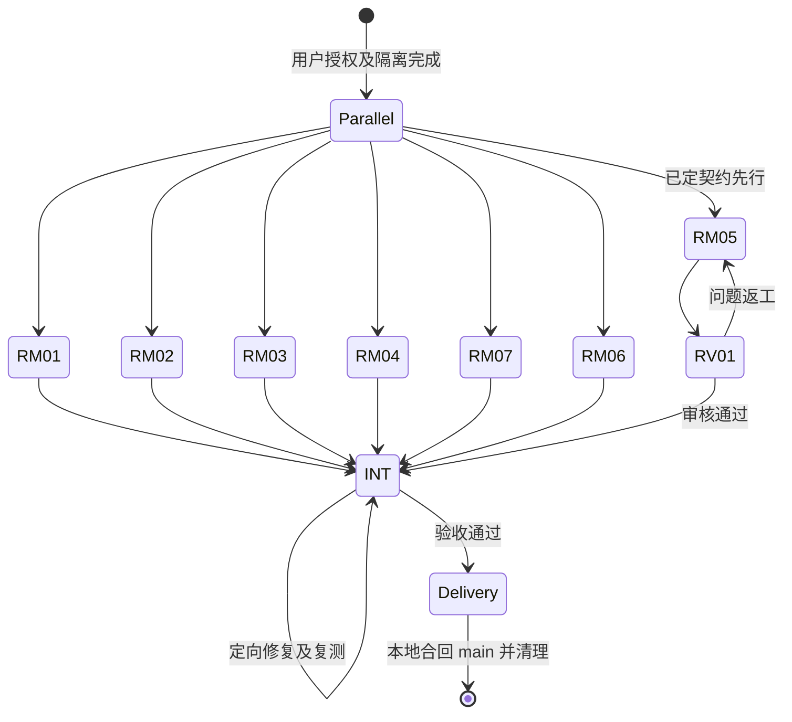

# Remote Mention P0～P2 执行记录

## 范围与隔离

- 用户授权：P0～P2；新增 `remote_delegation`、`remote_mention_grant` 两表，不改现有表；不开发 P3。
- 调度：仅 BeeCode 助手，实际绑定模型未确认；不使用 Orca。
- 原工作区：`/home/andy/git/beecode`，目标分支 `main`。
- 基线：`d25de404c5b70f97c1ef46644a7f5658b2d04944`，初始状态干净。
- 唯一集成/合回责任人：主会话。集成 worktree：`/home/andy/git/beecode/worktrees/wt_rm_int_20261111_0320`。
- 所有任务分支为 `worktrees/wt_rm_<后缀>_20261111_0320`，目录为原工作区下同名 `worktrees/` 路径。各写会话独占 worktree，先提交后集成。
- 共享槽位账本：`/home/andy/git/beecode/.git/agent-team/runs/rm_20261111_0320/slots.sqlite`。
- 已完成创建前与首次写入前的根目录、分支、HEAD、状态、worktree 核验；原有其他 worktree 不动。

## 团队与状态

| ID | 状态 | 助手 | worktree 后缀 | 宿主 task_id | 责任范围 |
| --- | --- | --- | --- | --- | --- |
| RM01 | 🔄执行中 | 复杂后端开发（3） | gateway | 192f5918-e62d-4e49-81d6-58a965e6ef80 | 网关、查询命令、公共注册 |
| RM02 | 🔄执行中（第3次） | 默认执行者（2） | reference | 42bee090-3089-4620-ba0a-82f0c3a9d3d6 | URI、徽标、导航、设置、全部 i18n |
| RM03 | 🔄执行中（第2次） | 复杂后端开发（3） | snapshot | f9070553-890f-424b-a171-d59c2eff7f4a | 快照、发送边界、快照事件类型 |
| RM04 | 🔄执行中 | 复杂后端开发（3） | db | c6d50b2e-1f73-4031-9c09-acb03a07989a | 两表、迁移、持久化服务 |
| RM07 | 🔄执行中 | 复杂后端开发（3） | routes | 996763cb-118a-4f9a-a89a-013725af99f0 | 路由帧、MCP 契约、能力探测 |
| RM06 | 🔄执行中 | 默认执行者（2） | cards | 42953628-816b-4af4-ad93-cad4ef37e3e9 | 卡片三来源、跳转、快照进度 UI |
| RM05 | 🔄执行中 | 复杂后端开发（3） | broker | 9922656d-e827-45ed-a30e-5c066d94a10d | listener/broker、跟踪、取消、恢复 |
| RV01 | ⏳待执行 | 规划与审核（4） | 只读固定提交 | 待派 | 权限、凭据、迁移、并发审核 |
| INT | 🔄协调中 | 主会话 | int | 当前会话 | 集成、验收、合回、清理 |

七项工单均已通过真实 `delegate_to_agent` 启动，不是仅规划。RM05 按契约先行，不以其他实现全部完成为人为屏障。只在最终集成点汇合。

RM05 负责人已按授权释放自己的执行槽并启动三个二级叶子，主会话只记录，不重复派发或干预其槽位：

| 子工单 | 宿主 task_id | 状态 |
| --- | --- | --- |
| RM05/listener | db8cc823-c762-4dec-92e8-9b98ff5294b6 | 🔄执行中 |
| RM05/run | c690aa13-7f09-4a07-93fc-a0f55af6a5c1 | 🔄执行中 |
| RM05/meta | d0a614b0-40c0-4925-a3f3-999873cf3920 | 🔄执行中 |

共享账本核验：父负责人 waiting、三个孩子 running，总执行槽 9（复杂后端开发 6、默认执行者 3），没有给二级额外额度。孩子隔离及提交证据由 RM05 回报后验收。

## 契约与共享文件责任

- `remote_gateway::call_allowed(db: &AppDatabase, connection_id: i32, command: &str, args: Option<Value>, timeout_ms: Option<u64>) -> Result<Value, AppCommandError>`；`hello(db, connection_id)`。
- 新查询命令只走本机 `getShellTransport()`；请求 camelCase，响应按设计各路由原有命名，不统一大小写。
- RM01 独占 `lib.rs`、`commands/mod.rs` 与 invoke 注册；RM03 独占 `manager.rs`、`commands/acp.rs`、`acp/types.rs`；RM07 独占 `connection.rs`、`agent_mentions.rs`、`lifecycle.rs` 及委派公共类型/伴生协议。
- RM05 不改上述文件，所需新增事件与启动 hook 由主会话集成。RM05 与 RM07 的 `delegation/mod.rs` 注册按内容确定性合并。
- RM02 独占 10 语言消息；RM06 使用约定文案键，额外键回报主会话，不并发修改语言文件。
- 快照 prepare 收集 grants，不提前写库。主会话集成时在 conversation_id 已确定、send_prompt_inner 之前接入 RM04 服务。
- 新远程事件与 `RemoteTaskInfo` 用 snake_case；远端 conversation_id 不填本机 child_* 字段。
- 公共契约改变会使受影响 mock 证据失效，集成后重验。

## 状态图

## 已提交与集成检查点（04:33）

| 模块 | 实际提交 | 验证证据 | 验收状态 |
| --- | --- | --- | --- |
| RM01 网关 | `cbdce8d4168a8c78745d56802826b89b3cbb21f8` | 网关7/7；server/mcp检查通过；桌面临时排除打包资源后源码检查通过 | 🧪已集成，待安全审核/真远程验收 |
| RM02 引用前端 | `c5b63baaa` | 执行者3次未给有效最终回报；主会话串行接管原worktree补齐；10套215/215、lint通过；tsc仅未改动locale测试基线错误 | 🧪已集成，GUI未验证 |
| RM03 快照 | `16cf665c28aa343d3c1f47ed5d7fc854ea8bd3d3` | 隔离核心6/6；原manager测试未执行 | 🧪已集成，项目级测试待补 |
| RM04 DB | `dfb5c1c5ae0d936c6cac33ac7c0bd91476d21146` | 4项内存库+1项迁移顺序通过 | 🧪已集成，独立复审中 |
| RM07 公共协议 | `266b0859ef29974bb41ece1b21c7584540424d71` | 隔离协议86/86；下游构造remote字段待RM05接入 | 🧪已集成，真链路未验 |
| RM06 卡片/进度 | `0c4912171ac62ffbd2cafbc9b55d4f65c57009b6` | 真实文案集成后Node22定向6套313/313 | 🧪已集成，跳转后端/重同步待接入 |
| INT 授权接入 | `b220f1077` | 绑定后登记，deleted连接登记失败保持fail-closed但降级消息继续；新增测试待项目编译 | 🔄待完整复测 |
| INT 文案类型 | `9691f5382` | 移除临时翻译类型绕过，真实键已合入 | ✅定向lint/测试通过 |
| INT URI/异步修复 | `8d2d02014` | 括号路径编码回归39/39；拥有引用副本修复Send/FnOnce错误，编译由37错降到12处下游缺remote字段 | 🧪待RM05后整体编译 |

- 集成分支已合入上述六项模块，不代表main已合回；main仍为初始基线，原工作区干净。
- Node运行时：默认PATH实际命中Node26，jsdom localStorage不可用；改用已装Node22后恢复。RM06旧全量报告1210失败不应用作本版结论。集成全量在200秒被工具终止，没有完整结论；定向215和313实际通过。
- 索引：INT已`codegraph init --yes`建立专属索引，后续sync遇活跃PID锁未强行解锁；RM02初始化超时，不能声称该分支索引最新。
- 审核：RV-SNAPSHOT尝试1、2及RV-DB尝试1均宿主child_rejected，无最终结论，不能视为通过。RV-SNAPSHOT第2次中间调查确认括号URI缺陷，主会话已修；最终独立复验仍缺。RV-DB第2次宿主 `1a2cde0c-8852-4683-8491-77d1ae4c4a27` 正在只读审核。
- RM05负责人仍waiting，listener/meta孩子已提交，run孩子运行中；不得越过负责人直接夺取孩子结果（主会话查询孩子ID返回unknown所有权限制）。

## 最新验证检查点（04:59）

- 主会话已在 INT 提交 `b9c911aee`：远程窗口新建携带conversationId，已打开窗口通过shell专属事件定位；前端保留remoteConnectionId/remoteWindowId，相关15/15测试通过。Rust侧需要RM05合入后桌面检查。
- Node22分片回归：`src/lib src/contexts src/hooks src/stores` 321文件/5503测试通过；chat/message/workspace/settings/layout 267文件/3660通过；conversations/files/browser/canvas/providers/connection/shared/ui/ai-elements/tasks/i18n/browser-agent 167文件/2259通过。共11422项，尚不等于整仓最终AC7完成。
- INT tsc仅剩未修改 `use-connection-lifecycle.locale.test.tsx:63` 基线错误；未顺手修无关测试。
- 快照Send/FnOnce错误已通过真实cargo check确认消失；当前12项错误都是RM05尚未合入的remote字段构造缺失，待下游合并后重验。
- RV-SNAPSHOT和RV-DB前两次规划审核均宿主child_rejected，最后第3次改BeeCode codex通道，模型unknown；实际task分别 `6f2af904-985c-47c3-8da7-0b8f9876693e`、`0c645169-96c1-437a-90a9-255bb362e917`，仍执行中，没有结论不标通过。
- RM05负责人已集成子模块，固定提交 `aedf9d9fc`，其后还有未提交编译修正；其隔离验证副本发现meta Option类型错误正修复；不提前合入不稳定工作文件。

## 验证与交付门禁

1. 各执行者定向测试、diff 检查、任务分支提交；主会话按 AC 核对，不以 done 代替验收。
2. 在集成 worktree 汇合后补真实类型/调用链、授权登记、事件、启动恢复接入，针对受影响证据重验。
3. 独立 reviewer 核对固定最新提交的 hello/凭据/白名单、迁移、授权、取消竞态及恢复；问题返工最多一轮，未解明确报告。
4. 前端 lint/test，Rust 桌面/server/mcp feature 检查按环境执行，失败与未验证项如实记录。
5. 临时服务使用独立数据目录和端口，不用原工作区已有服务冒充任务分支。FRP 真跨机链路尚未验证，需要明确测试目标及运行权限。
6. 合回前复核 main 分支、HEAD、原工作区状态；未验收不合回。确认 main 包含已验提交后才清理本次干净 worktree/分支与自有进程。

## 环境与已知限制

- 宿主注入的 `GIT_CONFIG_COUNT` 缺少对应 key；Git 操作用 `env -u GIT_CONFIG_COUNT git`，不修改全局配置。
- 本机无 `python` 别名，槽位脚本使用 `python3`。
- 初次槽位初始化因父目录不存在返回 invalid；创建本任务 `.git/agent-team/runs/` 目录后初始化成功，没有重建其他账本。
- `deja` 已检索 remote-mention/跨机；无可直接沿用的本需求历史结论。
- `humanizer` 不在可用技能中，未加载；Codegraph 可用定位，但索引更新能力须以实际工具确认，不能虚称已更新。
- 中断事件：RM01 宿主因 parent canceled 中断，已在原 task_id 恢复；RM02 原宿主 `4a4a6e8d-a37d-4ce8-8e0d-92391ab68bc7`、RM03 原宿主 `253875e2-a6d9-4c79-9ce4-225289ea5476` 均 child_rejected。核对两个 worktree 干净、HEAD 未推进后，保留原逻辑 ID 与 worktree 启动第2次尝试，历史不删除。这不是代码验收失败。
- RM02 第2次宿主 completed 但回报为空。核对实际现场：已有10个前端修改/新文件、无提交，未见文案和验证证据。按格式不符处理为未验收，保留产物，原逻辑ID第3次（最后一次）派给同助手补齐，不重新从头实现。
- RM05/listener 已向负责人回报提交 `44ee32d0`；尚未经父级集成和主会话验收，不能标已完成。
- Codegraph CLI `status` 在任务目录向上解析到原工程索引，不代表任务分支已有独立索引；后续不得误报分支索引已更新。CLI 提供 `sync`，如需更新必须定位任务分支专属索引。
- 宿主 PATH 未找到 cargo，常见 `/home/andy/.cargo/bin/cargo` 和 `/usr/local/cargo/bin/cargo` 也未发现；已存在本地 Rust 工具链镜像 `codeg-skill-import-toolchain:local`，RM04 正使用其自有容器验证。不能擅自进入其他任务旧容器写构建产物。
- `docs/superpowers` 被工程忽略，本执行记录暂为任务 worktree 内检查点；需要纳入交付时只定向添加该文件，不修改整体忽略规则。
- 本记录为开发进行时检查点：当前尚未有完成/提交/集成/合回/清理证据。
