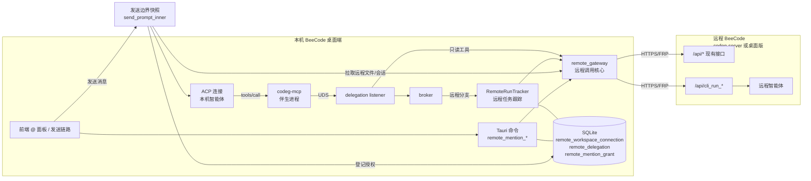
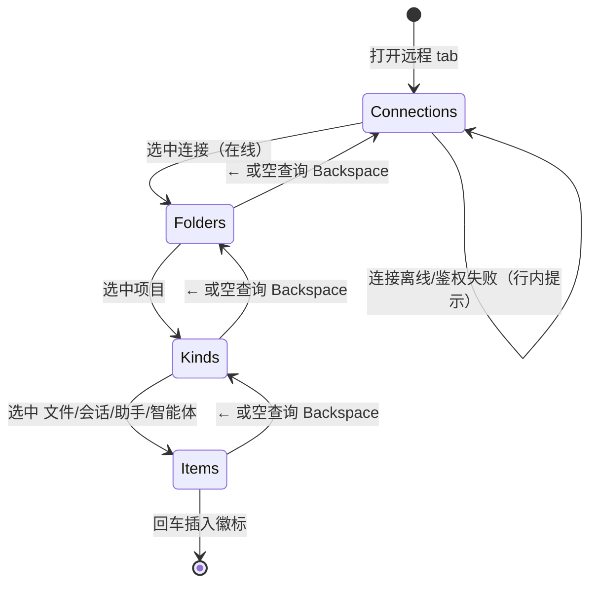
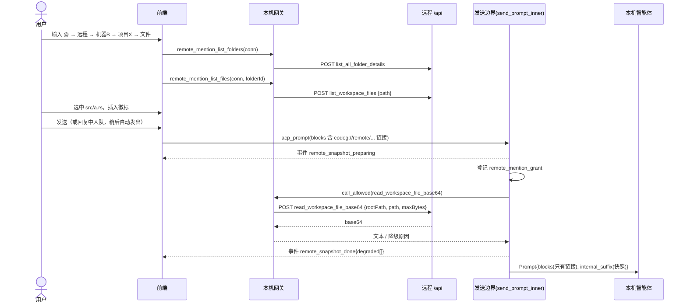
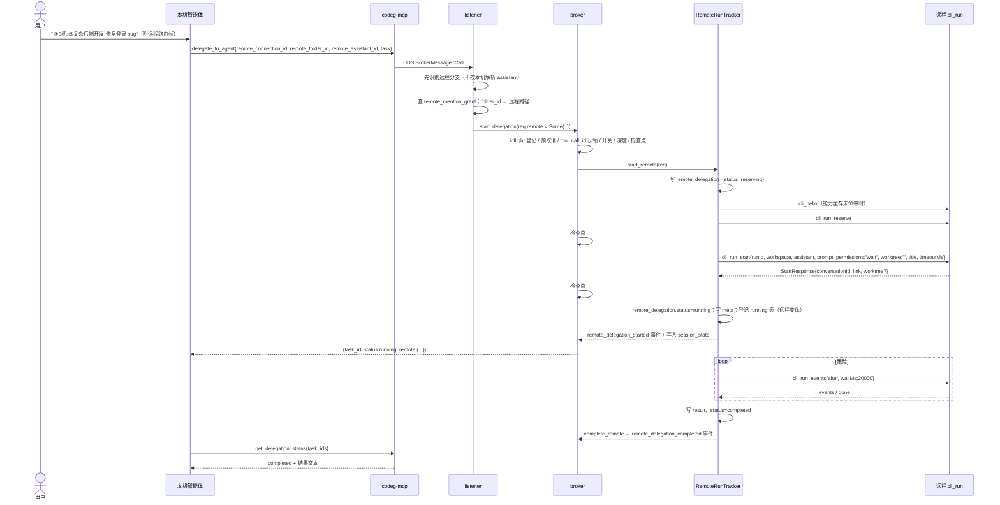
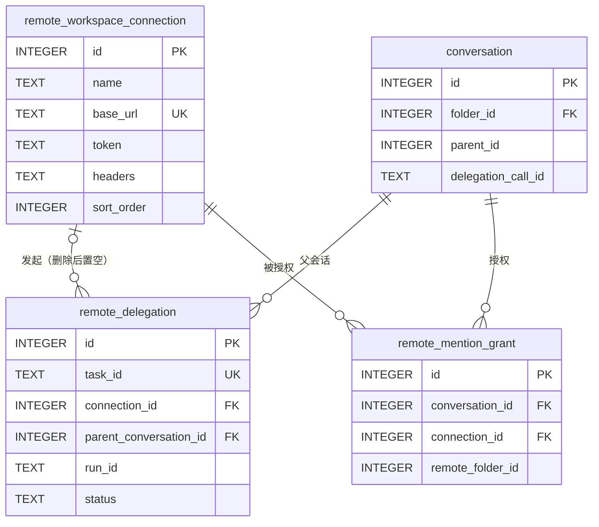
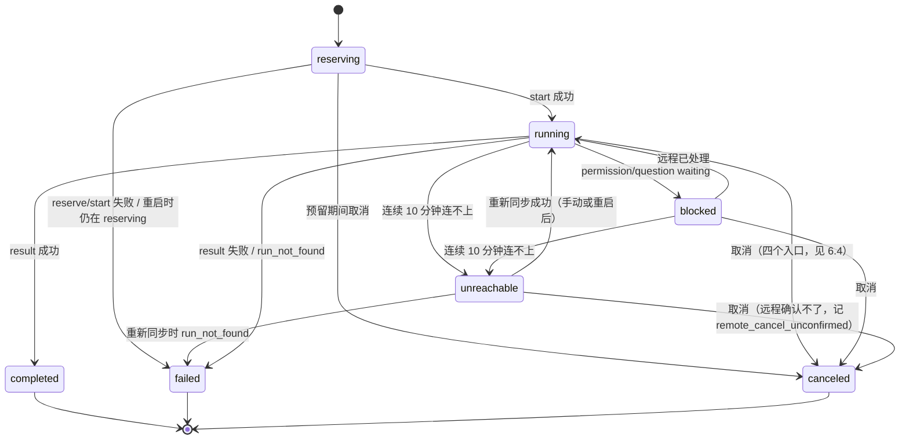
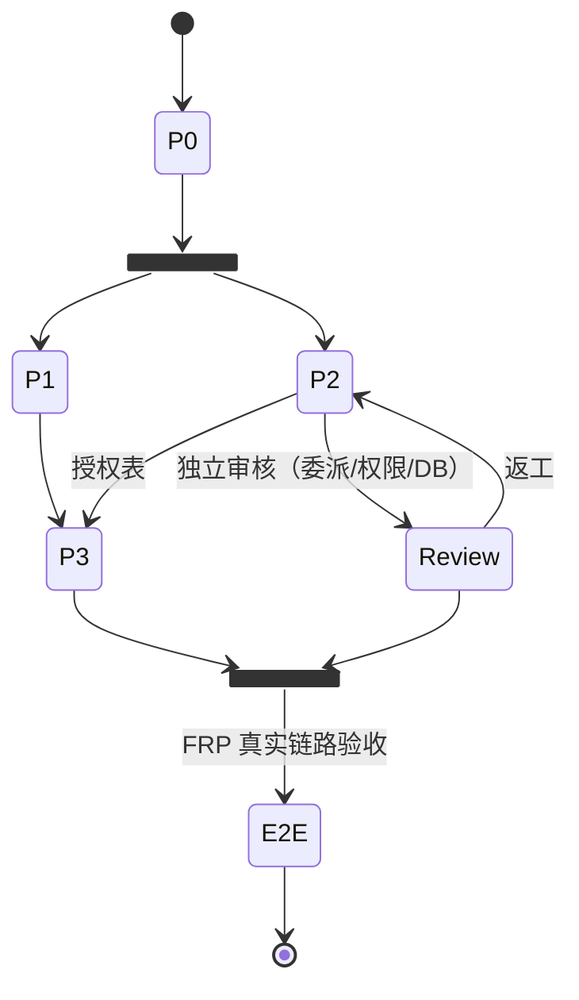

# BeeCode 跨机 @ 引用（远程工作区互联）详细设计说明书

## 文档信息

| 项目 | 内容 |
| --- | --- |
| 文档状态 | [√] 草稿　[ ] 修订　[ ] 发布 |
| 文档编号 | BEECODE-SD-REMOTE-MENTION-001 |
| 版本号 | V0.2 |
| 编写日期 | 2026-11-11 |
| 适用代码基线 | `main@14439b32a`（BeeCode 0.42.4） |
| 保密级别 | 内部 |

### 修订记录

| 序号 | 变更日期 | 版本 | 变更位置 | 变更原因 | 修订人 | 审核人 | 批准人 |
| --- | --- | --- | --- | --- | --- | --- | --- |
| 1 | 2026-11-11 | V0.1 | 全文 | 初稿 | 主智能体 | 待定 | 待定 |
| 2 | 2026-11-11 | V0.2 | 4.1.3、4.1.4、4.1.5、5.5、6.5、7.1、7.5、8、9.3、9.4、13 | 独立审核 RV1 提出 4 项阻断、5 项重要问题 | 主智能体 | 规划与审核（RV1） | 待定 |

### 本文已确认的产品决策

| 编号 | 决策 | 来源 |
| --- | --- | --- |
| D1 | 只考虑**同一个人的多台机器**，暂不做多人协作 | 用户回复 |
| D2 | 远程机器通过 **FRP 映射到公网** 访问 | 用户回复 |
| D3 | 采用组合方案：**A 快照 + B1 远程只读工具 + B2 远程智能体执行** | 用户回复"1" |
| D4 | 远程连接沿用现有"远程工作区连接"，不另建身份体系 | 方案评审 |

### 待用户确认项（不影响本文结构，影响默认值）

| 编号 | 问题 | 本文暂定（推荐） |
| --- | --- | --- |
| Q1 | 远程机器运行形态：`codeg-server` 还是桌面版 | 两种都支持，按 `cli_hello.runtime` 区分 |
| Q2 | B2 默认权限策略 | `wait`：权限请求留给人在远程界面处理 |
| Q3 | B2 默认是否在远程新建 git worktree | 是（远程目录是 git 仓库时） |
| Q4 | 快照上限 / 会话注入轮数 | 256 KiB / 最近 10 轮 |
| Q5 | 启动范围 | 先做 P0 + P1 + P2，P3 视效果决定 |
| Q6 | 是否授权新增数据库表 `remote_delegation` + `remote_mention_grant`（P2） | 授权（不改现有表） |
| Q7 | Web 模式（浏览器访问 codeg-server）本期不支持，是否接受 | 接受；你目前用桌面端访问远程 |
| Q8 | 公网明文 HTTP：只提示，还是禁止发送 token | 只提示，可在设置中改为禁止 |
| Q9 | "未被 @ 则拒绝远程委派"是否默认开启 | 默认开启，设置中可放开 |
| Q10 | 删除远程连接时如何处理运行中的远程任务和历史 | 先取消运行中的远程任务，历史保留（外键置空） |

---

## 1. 文档介绍

### 1.1 编写目的

本文档描述 BeeCode"跨机 @ 引用"功能的详细设计，目的是：

1. 统一功能边界、交互流程、接口契约和数据结构，作为开发、测试和评审的共同依据；
2. 记录对现有代码的核实结论（附文件与行号），避免实现时建立在错误假设上；
3. 作为分阶段交付（P0～P3）和验收的依据。

### 1.2 文档范围

覆盖：功能设计（@ 面板、引用、快照、远程委派、远程只读工具）、架构设计（模块划分、调用链、时序）、接口设计（复用的远程 HTTP 接口、新增 MCP 工具、内部接口）、数据库设计（新增表与字段）、安全设计、异常处理、测试与验收、分阶段计划。

不覆盖：多人协作和权限分级账号体系、NAT 穿透（由 FRP 负责）、远程 codeg-server 的部署运维。

### 1.3 读者对象

BeeCode 的开发人员、审核人员和测试人员。

### 1.4 术语与缩写解释

| 术语 | 解释 |
| --- | --- |
| 本机 | 用户正在操作的 BeeCode 桌面端 |
| 远程 / 远程端 | 通过"远程工作区连接"访问的另一台机器上的 BeeCode（`codeg-server` 或开启了 Web 服务的桌面版） |
| 远程连接 | `remote_workspace_connection` 表中的一行，含 `base_url`、`token`、自定义 headers |
| 远程项目 | 远程端 `folder` 表中的一行（远程 `list_all_folder_details` 返回） |
| 引用 / @ 引用 | 在输入框里通过 `@` 插入的徽标，序列化为 `codeg://…` 或 `file://` 链接 |
| A 快照 | 发送时把远程文件内容拉回本机，作为 `resource` 块嵌入消息 |
| B1 | 本机智能体通过 codeg-mcp 新增的只读工具按需读取远程文件 |
| B2 | 委派任务给远程机器上的智能体执行，本机只展示过程与结果 |
| codeg-mcp | 注入到智能体的 stdio MCP 伴生进程，提供 `delegate_to_agent` 等工具 |
| broker | 本机主进程内的委派调度器（`acp/delegation/broker.rs`） |
| cli_run | 远程执行接口族 `/api/cli_run_*`，`codeg-cli --url` 也使用它 |
| 路由帧 | 发给智能体前追加的一段内部文本，告诉它用哪个工具委派（`acp/agent_mentions.rs`） |
| FRP | 内网穿透工具，把远程机器端口映射到公网 |

### 1.5 参考资料

| 序号 | 文档名称 | 位置 | 版本 |
| --- | --- | --- | --- |
| 1 | 项目开发约定 | `AGENTS.md` / `CLAUDE.md` | 当前 |
| 2 | UI 样式规范 | `docs/design/ui-style-guide.md` | 当前 |
| 3 | CLI 使用说明 | `docs/cli.md` | 当前 |
| 4 | URL scheme 说明 | `docs/url-scheme.md` | 当前 |
| 5 | 反向代理鉴权 | `docs/proxy-auth.md` | 当前 |
| 6 | 功能设计说明书模板 | 用户附件《功能设计说明书 - 示例.docx》 | — |
| 7 | 数据库设计说明书模板 | 用户附件《数据库设计说明书 - 示例.docx》 | — |

---

## 2. 项目介绍

### 2.1 项目说明

| 项目 | 内容 |
| --- | --- |
| 功能名称 | 跨机 @ 引用（Remote Mention） |
| 所属产品 | BeeCode（原 Codeg）多智能体编码工作台 |
| 任务提出者 | 用户本人 |
| 开发者 | BeeCode 项目组（主智能体 + 子智能体） |
| 用户群 | 在多台机器（笔记本、家里/机房服务器、云主机）上使用 BeeCode 的个人开发者 |

### 2.2 项目背景

BeeCode 已经支持"远程工作区"：桌面端保存远程连接后，可以打开一个**完全指向远端**的独立窗口。但本机会话的 `@` 面板只能引用本机的文件、智能体、助手、会话和提交（`src/components/chat/composer/use-reference-search.ts:104` `buildReferenceGroups`）。如果要用远程机器的资源，只能切换窗口、复制粘贴，或在远程窗口里另开会话，无法在一个会话里组合多台机器的上下文和算力。

### 2.3 项目目标

1. 在本机会话的 `@` 面板中浏览并引用任意已保存远程连接上的**文件、会话、助手、智能体**；
2. `@远程文件` 默认以快照方式交给本机智能体；超过上限的文件和需要的相邻文件，由智能体通过只读工具按需读取；
3. `@远程助手/智能体` 时，任务在**远程机器上**执行，本机委派卡片展示状态、结果，并可跳转查看远程会话；
4. 远程机器不升级也能用 P1、P2（只依赖远程现有接口）；
5. 不降低现有本机功能的安全性和稳定性。

### 2.4 项目用户

单个用户，拥有所有涉及机器的完全控制权，并持有每台远程机器的 `CODEG_TOKEN`。

---

## 3. 需求说明

### 3.1 整体需求

| 编号 | 需求 | 优先级 | 阶段 |
| --- | --- | --- | --- |
| R1 | @ 面板出现"远程"分组：连接 → 远程项目 → 文件/会话/助手/智能体 | 高 | P1 |
| R2 | 发送时，≤256 KiB 的远程文本文件以快照嵌入；超限、二进制或读取失败降级为指针并提示 | 高 | P1 |
| R3 | `@远程会话` 注入会话摘要 + 最近 10 轮 | 中 | P1 |
| R4 | `@远程助手/智能体` 时，本机智能体通过 `delegate_to_agent` 委派到远程执行 | 高 | P2 |
| R5 | 远程委派可查询状态、取消，结果回到本机，卡片可跳转远程会话 | 高 | P2 |
| R6 | 本机智能体可通过 `remote_read_file` / `remote_list_dir` 只读访问**已引用的远程项目** | 中 | P3 |
| R7 | 远程连接为公网明文 HTTP 时，在保存和首次使用时给出风险提示 | 高 | P0 |
| R8 | 所有远程访问都有日志，日志不含 token 和文件正文 | 高 | P0 |

### 3.2 功能需求

#### 3.2.1 需求编号规则

需求编号：`rm`（Remote Mention）+ 模块代码 + 三位功能点序号。

| 模块代码 | 模块 |
| --- | --- |
| `gw` | 远程网关公共层（P0） |
| `ui` | @ 面板与引用（P1） |
| `sn` | 快照（P1） |
| `dl` | 远程委派（P2） |
| `rt` | 远程只读工具（P3） |
| `jk` | 接口（对外/对内） |

#### 3.2.2 总体模块划分

分为业务功能模块（`rmgw`、`rmui`、`rmsn`、`rmdl`、`rmrt`）和接口模块（`rmjk`）。

---

## 4. 功能性需求（功能设计）

### 4.1 业务功能需求

| 模块名称 | 跨机 @ 引用 |
| --- | --- |
| 模块简介 | 在本机会话中引用和使用远程机器的文件、会话、助手、智能体 |

**模块功能列表**

| 序号 | 一级功能 | 功能编号 | 二级功能 | 功能编号 |
| --- | --- | --- | --- | --- |
| 1 | 远程网关 | rmgw001 | 远程调用核心 | rmgw001001 |
| | | | 能力探测与连接状态 | rmgw001002 |
| | | | 明文风险提示 | rmgw001003 |
| 2 | @ 面板远程分组 | rmui001 | 连接与项目导航 | rmui001001 |
| | | | 远程资源搜索与插入 | rmui001002 |
| | | | 远程引用徽标渲染与还原 | rmui001003 |
| 3 | 快照 | rmsn001 | 远程文件快照 | rmsn001001 |
| | | | 远程会话摘要注入 | rmsn001002 |
| 4 | 远程委派 | rmdl001 | 远程路由帧 | rmdl001001 |
| | | | 远程任务启动 | rmdl001002 |
| | | | 状态、取消与结果 | rmdl001003 |
| | | | 卡片展示与跳转 | rmdl001004 |
| 5 | 远程只读工具 | rmrt001 | 远程读文件 | rmrt001001 |
| | | | 远程列目录 | rmrt001002 |

#### 4.1.1 远程网关 rmgw001

##### 4.1.1.1 远程调用核心 rmgw001001

| 名称 | 远程调用核心 | 需求编号 | rmgw001001 |
| --- | --- | --- | --- |
| 功能描述 | 提供与运行模式无关的远程 HTTP 调用函数，供前端命令、broker、MCP 监听器共用。现有 `remote_http_call` 是纯 Tauri 命令，且所在模块 `commands::remote_proxy` 整体只在 `tauri-runtime` 下编译（`src-tauri/src/commands/mod.rs:73-74`），broker 和 server 模式都用不了，所以需要抽出公共层 |
| 参与用户 | 系统内部 |
| 输入 | 连接 ID、远程命令名、JSON 参数、超时 |
| 操作序列 | 1）按 ID 读取连接（`remote_workspace_connection_service::get`，两种模式都可用）；2）拼 `{base_url}/api/{command}`，带 `Authorization: Bearer <token>` 和自定义 headers；3）发送并解析响应 |
| 扩展及异常 | 401 → `authentication_failed`；非 2xx 时先尝试按 `AppCommandError` 解析，再按 cli_run 的 `ErrorBody{subtype,error}` 解析，否则作为 `network_error`；超时可按请求覆盖，上限 600 s（沿用 `HTTP_TIMEOUT_MAX`） |
| 输出 | JSON 值或结构化错误 |
| 补充说明 | 新模块 `src-tauri/src/remote_gateway/`，不带 `cfg(feature)`。现有 `remote_http_call` 改为调用它，行为不变（含 resource-monitor 的 GET/PUT 映射） |

##### 4.1.1.2 能力探测与连接状态 rmgw001002

| 名称 | 能力探测 | 需求编号 | rmgw001002 |
| --- | --- | --- | --- |
| 功能描述 | 首次使用某连接时，调用远程 `/api/cli_hello`，确认对方是 BeeCode、版本、运行形态（desktop/server）和能力列表（如 `run`、`worktree`）；结果在内存缓存 10 分钟 |
| 参与用户 | 系统内部 |
| 输入 | 连接 ID |
| 操作序列 | 生成 16 字节随机 nonce → `POST /api/cli_hello {nonce, clientVersion, apiVersion:1}`（不带 token）→ 用本地保存的 token 校验 `proof`（`cli_run::hello::verify`，`port=None`） |
| 扩展及异常 | proof 校验失败：判定为"地址指向的不是这台 BeeCode 或 token 不对"，禁止发送 token 以外的任何请求，提示用户检查连接；远程没有 `run` 能力：禁用 B2，P1 仍可用 |
| 输出 | `RemoteCapabilities{runtime, version, apiVersion, capabilities[]}` |
| 补充说明 | 先 hello、再带 token，可避免把 token 发给被劫持或配错的地址。机制与 `codeg-cli --url` 相同（`src-tauri/src/cli_run/hello.rs:1-12`） |

##### 4.1.1.3 明文风险提示 rmgw001003

| 名称 | 明文风险提示 | 需求编号 | rmgw001003 |
| --- | --- | --- | --- |
| 功能描述 | `base_url` 为 `http://` 且主机不是回环、私网（10/8、172.16/12、192.168/16、100.64/10、fc00::/7）或 `.local` 时，在连接编辑对话框显示警告，首次在 @ 面板使用时 toast 提示一次 |
| 参与用户 | 用户 |
| 输入 | 连接的 `base_url` |
| 操作序列 | 保存连接或首次展开远程分组时判断并提示 |
| 扩展及异常 | 不阻止使用，只提示。FRP 建议用 https 类型代理或 stcp |
| 输出 | 警告文案 |
| 补充说明 | token 拥有远程整机权限（见第 8 章），经明文公网传输风险很高 |

#### 4.1.2 @ 面板远程分组 rmui001

##### 4.1.2.1 连接与项目导航 rmui001001

| 名称 | 连接与项目导航 | 需求编号 | rmui001001 |
| --- | --- | --- | --- |
| 功能描述 | @ 面板新增"远程"tab。tab 内是一个三层列表：连接 → 远程项目 → 资源类型（文件/会话/助手/智能体）。已选层级显示在面板顶部的面包屑里 |
| 参与用户 | 用户 |
| 输入 | 键盘或鼠标 |
| 操作序列 | 1）输入 `@`，切换到"远程"tab（也可在设置里把它排进 tab 顺序）；2）列出远程连接；3）回车或点击进入某连接，懒加载 `list_all_folder_details`；4）进入项目后选资源类型；5）在该层输入关键字搜索；6）`Backspace`（查询为空时）或 `←` 返回上一层 |
| 扩展及异常 | 连接离线：该行显示"离线"并禁用；鉴权失败：显示"token 无效"；远程无 `run` 能力：助手/智能体两类置灰 |
| 输出 | 当前层级的列表 |
| 补充说明 | **仅在桌面端的本机窗口显示**（`isDesktop() && !isRemoteDesktopMode()`）。连接列表在本机数据库，Web 模式没有对应路由；远程窗口里的会话跑在远端，无法使用本机连接（见 5.5） |

**设计依据**：现有面板的分组和 tab 都是封闭的 `ReferenceKind` 联合类型，弹窗按 kind 建 Map（`suggestion/suggestion-popup.tsx:230-233`），没有下钻状态。如果把每个连接做成一个分组，同 kind 的分组会互相覆盖，同名路径的 React key 也会冲突。因此本设计**只新增一个 kind `remote`**，在这个 tab 内部维护一个小的导航状态机（第 5.4 节），不改动其他 tab 的行为。

##### 4.1.2.2 远程资源搜索与插入 rmui001002

| 名称 | 远程资源搜索与插入 | 需求编号 | rmui001002 |
| --- | --- | --- | --- |
| 功能描述 | 在"资源类型"层搜索并插入远程引用徽标 |
| 参与用户 | 用户 |
| 输入 | 搜索关键字 |
| 操作序列 | 文件：`list_workspace_files {path: 项目路径}` 取全量列表，本机做子串过滤（与本机文件组一致），最多显示 50 条；会话：`list_all_conversations {folderIds:[项目id]}`；助手：`cli_assistants`（只返回启用且未删除的）；智能体：`cli_agents` 中 `enabled && installed` 的项。选中后插入 `reference` 节点，`refType="remote"` |
| 扩展及异常 | 文件列表超过 20000 条时只缓存前 20000 条，并提示"结果已截断，请输入更精确的路径"；请求超过 8 s 显示加载失败，可重试 |
| 输出 | 编辑器中的远程徽标 |
| 补充说明 | 每个连接+项目的列表在内存缓存 60 秒。徽标文字形如 `机器名:路径` 或 `机器名:@助手名`，悬停显示完整 URI |

##### 4.1.2.3 远程引用徽标渲染与还原 rmui001003

| 名称 | 远程徽标渲染与还原 | 需求编号 | rmui001003 |
| --- | --- | --- | --- |
| 功能描述 | 让远程引用在编辑器、草稿还原、会话记录中都显示为徽标，而不是"不支持的链接" |
| 参与用户 | 用户 |
| 输入 | `codeg://remote/...` URI |
| 操作序列 | 解析见第 5.2 节 URI 语法 |
| 扩展及异常 | 连接已删除：徽标显示为灰色"已失效"，点击提示连接不存在 |
| 输出 | 徽标 |
| 补充说明 | 已核实**不需要改**的地方：节点白名单 `nodes/reference-node.ts:26` 只按 `codeg:` 前缀判断；Streamdown sanitize 已经放行 `codeg` 协议（`ai-elements/rehype-allow-codeg.ts:71`）；用户气泡的 scheme 判断 `message/user-message-segments.ts:26` 已包含 `codeg:`。**必须改**：`reference-uri.ts` 增加解析分支；`reference-text.ts` 增加序列化分支（否则落入 default，URI 丢失）；`badges/reference-badge.tsx` 增加图标；类型 `composer/types.ts` 增加 kind 与 meta |

#### 4.1.3 快照 rmsn001

##### 4.1.3.1 远程文件快照 rmsn001001

| 名称 | 远程文件快照 | 需求编号 | rmsn001001 |
| --- | --- | --- | --- |
| 功能描述 | 消息**真正发给智能体的那一刻**，后端把消息中每个远程文件引用的内容拉回本机，作为内部后缀块追加给智能体。用户消息本身（存库、广播、标题、乐观气泡）只保留 `codeg://remote/...` 链接，不含正文 |
| 参与用户 | 用户、本机智能体 |
| 输入 | 发往智能体的 `PromptInputBlock` 列表中的远程文件链接 |
| 操作序列 | 1）UI 的直接发送和队列自动发出都经 `acp_prompt` → `send_prompt_linked_with_resume` 汇集到 `ConnectionManager::send_prompt_inner`（`acp/manager.rs:1223`），并带 `remote_snapshot: true`（其他入口为 `false`，见第 8 章 S10）；2）在空消息检查之后、`cmd_tx.reserve()` 之前，扫描文本块里的 `codeg://remote/<c>/file/...` 与 `.../session/...` 链接（没有就走原流程，行为零变化）；3）并发（最多 4 个）调用远程 `read_workspace_file_base64 {rootPath: 项目路径, path: 相对路径, maxBytes: 262144}`；4）base64 解码，按 UTF-8 严格解码且前 8 KiB 不含 NUL 判定为文本；5）智能体支持 `embedded_context` 时生成 `Resource{uri, mimeType:"text/plain", text}`，不支持时生成等价的文本块（`uri\n<context ref="uri">\n正文\n</context>`，与页面附件的退化方式一致）；6）失败或超限的生成一段说明文本（降级为指针）；7）结果并入 `internal_suffix`，随 `ConnectionCommand::Prompt` 一起交给连接循环 |
| 扩展及异常 | 超过 256 KiB：降级为指针，正文写"文件 N KiB 超过快照上限，可用 remote_read_file 分段读取"（P3 前写"请用远程智能体处理"）；二进制：降级并说明；404/鉴权失败/超时（整体 30 s）：降级，并发出 `remote_snapshot_degraded` 事件，前端据此 toast；单条消息快照总量超过 1 MiB：按引用顺序装入，后面的降级 |
| 输出 | 智能体收到的 ACP `EmbeddedResource`（`acp/connection.rs:13152-13176` 把 `PromptInputBlock::Resource` 映射为它），或退化文本块 |
| 补充说明 | **只用 `read_workspace_file_base64`**：它会先 canonicalize 再判断是否仍在根目录内，并用 `O_NOFOLLOW` 打开，防止软链接逃逸（`commands/folders.rs:5509-5579`）。不使用 `read_file_preview`（不 canonicalize，`ensure_user_navigable_path` 故意放开软链接，`commands/folders.rs:4464`）或 `read_file_base64`（无根目录约束） |

**为什么放在后端发送边界，而不是前端发送按钮（V0.2 修订）**：

V0.1 设计在前端 `handleSend` 里异步预取，审核指出它覆盖不了所有发送路径：

- `handleSend`（`message-input.tsx:1642`）有三个出口：保存队列编辑（`:1660`）、回复中入队（`:1667`）、直接发送（`:1683`）；
- 排队消息由 `conversation-detail-panel.tsx:933` 的 `autoSendQueueRef` 在回合结束后自动取出发送，完全不经过 `MessageInput`；
- 插话（`message-input.tsx:1736`）、快捷消息（`:1708`）也各自构造草稿；
- 入队时做快照，到真正发出时内容可能已过期；在前端快照还会让编辑重发时出现"旧快照 + 新快照"两份（`from-prompt-blocks.ts` 会把 `resource` 块还原成 `codeg://embedded` 附件徽标）。

所有这些路径最终都进入同一个后端入口 `send_prompt_inner`（`acp/manager.rs:1223`），而它已经支持 `internal_suffix`：只发给智能体、不存库、不广播、不进标题（`manager.rs:1458` 注释，assistant brief 帧就是这么传的）。把快照放在这里：

1. 前端发送链路**完全不改**，入队、队列编辑、自动发出、插话的行为与现在一致；
2. 快照在真正发出时拉取，内容总是最新；
3. 用户消息里只有链接，草稿还原和编辑重发自然不会重复；
4. 智能体能力判断（`embedded_context`）在后端连接状态里现成可查。

代价和对应措施：

- `send_prompt_inner` 在 `reserve()` 之前增加最多 30 s 的网络等待。只有消息含远程链接时才会等；等待发生在设置 `turn_in_flight` 之前，不会卡住并发闸门（闸门的设计要求"设置标志与入队之间没有 await"，见 `manager.rs:1254-1267` 注释，本改动不破坏这一点）；
- 等待期间前端没有回合开始事件，所以新增 `remote_snapshot_preparing{connection_id, count}` / `remote_snapshot_done{degraded[]}` 事件，前端在输入框上方显示"正在获取远程文件（N）…"；
- 插话（steer）走的是实时反馈通道，不经过 `send_prompt_inner`。插话消息里的远程链接**不做快照**，按原样作为链接送达，并在 4.1.3 的限制里写明；
- 聊天渠道（Telegram 等）、`cli_run`、自动化发来的消息不做快照（入口参数为 `false`）。

不在插入徽标时预取，是因为用户可能插入后又删掉，提前拉取会浪费流量，也拿不到最新内容。

##### 4.1.3.2 远程会话摘要注入 rmsn001002

| 名称 | 远程会话摘要注入 | 需求编号 | rmsn001002 |
| --- | --- | --- | --- |
| 功能描述 | `@远程会话` 时，在发送边界（与 4.1.3.1 同一处）取远程会话的标题、智能体、状态，以及最近 10 轮的文本内容，作为内部后缀块交给智能体 |
| 参与用户 | 用户、本机智能体 |
| 输入 | 远程会话引用（远程 conversation id） |
| 操作序列 | `POST /api/get_folder_conversation {conversationId, tailTurns: 10}` → 每轮只取文本块，工具调用压缩为一行"[工具] 标题 状态"→ 每轮最多 4 KiB，总量最多 64 KiB |
| 扩展及异常 | 会话不存在：降级并提示；会话进行中：照常取，并注明"会话仍在进行，内容截至 HH:mm" |
| 输出 | `resource{uri: codeg://remote/<c>/session/<id>, text: 摘要}` |
| 补充说明 | 必须用 DB 语义的 `get_folder_conversation`，不能用按 agent 解析本地记录的旧接口 `get_conversation`（id 语义不同） |

#### 4.1.4 远程委派 rmdl001

##### 4.1.4.1 远程路由帧 rmdl001001

| 名称 | 远程路由帧 | 需求编号 | rmdl001001 |
| --- | --- | --- | --- |
| 功能描述 | 消息中出现 `codeg://remote/<c>/assistant/<id>` 或 `.../agent/<slug>` 时，在发给智能体前追加一个新的"远程路由帧"，告诉它用 `delegate_to_agent` 并带上 `remote_connection_id`、`remote_folder_id` 和 `remote_assistant_id`/`remote_agent` |
| 参与用户 | 系统、本机智能体 |
| 输入 | 消息文本块 |
| 操作序列 | 在 `prepare_agent_bound_prompt`（`acp/connection.rs:13200`）中，`append_assistant_routes` 之后调用新的 `append_remote_routes` |
| 扩展及异常 | 委派开关关闭时不追加；最多 8 个不同的远程目标；帧最大 16 KiB |
| 输出 | 追加的内部文本块（不进入广播、预览、标题） |
| 补充说明 | 现有帧以"逐字节可重新渲染"作为身份校验（`agent_mentions.rs:226-247`），往 v3 帧里加字段会让历史记录里的旧帧失效。因此**新增帧 kind** `codeg_internal_remote_routes`（version 1），仿照 assistant 帧的实现，加入 `FRAME_KINDS`，复用现有的剥离和标题截断逻辑。帧里给出的是 `remote_folder_id`（不是绝对路径），智能体照抄即可，broker 再换算成远程路径。这样远程目录结构不会出现在提示词里，与 5.2 节的 URI 设计一致 |

##### 4.1.4.2 远程任务启动 rmdl001002

| 名称 | 远程任务启动 | 需求编号 | rmdl001002 |
| --- | --- | --- | --- |
| 功能描述 | broker 收到带 `remote_connection_id` 的委派请求时，不在本机启动子智能体，而是调用远程 `cli_run_reserve` + `cli_run_start` |
| 参与用户 | 本机智能体、broker |
| 输入 | `delegate_to_agent{remote_connection_id, remote_folder_id, remote_assistant_id 或 remote_agent, task, permissions?}` |
| 操作序列 | 见第 6.3 节时序 |
| 扩展及异常 | 远程 `run_not_reserved`（409）：重新 reserve 一次再 start；`unknown_assistant` / `no_agent` / `workspace_not_found`：立即失败，错误原样返回给智能体；远程离线：失败，`error_code=remote_unavailable` |
| 输出 | `DelegationTaskReport{status: running, task_id, remote: {...}}` |
| 补充说明 | 远程目标用**独立参数名** `remote_assistant_id` / `remote_agent`，不复用本机的 `assistant_id` / `agent_type`。原因：listener 一看到 `assistant_id` 就会按本机解析助手（`listener.rs:1364-1368`），远程助手 id 恰好与本机某个助手相同时会在本机误跑另一个助手；本机 `agent_type` 是封闭枚举，远程自定义智能体的 slug 解析不出来。listener 必须在解析目标**之前**先判断 `remote_connection_id`。`remote_folder_id` 由 broker 按远程 `list_all_folder_details` 换算为绝对路径，换算不到就拒绝。原因：远程 `cli_run_start` 会对任意目录自动登记 folder（`cli_run/service.rs:755-760`），本机必须先拦住 |

##### 4.1.4.3 状态、取消与结果 rmdl001003

| 名称 | 状态、取消与结果 | 需求编号 | rmdl001003 |
| --- | --- | --- | --- |
| 功能描述 | 本机 broker 为每个远程任务启动一个跟踪协程，长轮询远程 `cli_run_events`，把事件映射为本机委派状态 |
| 参与用户 | 本机智能体、用户 |
| 输入 | 远程事件流 |
| 操作序列 | `cli_run_events{runId, after: 游标, waitMs: 20000}` 循环；`permission(decision=waiting)` / `question(waiting)` → `blocked_on`；`result` → 完成，取 `result.result` 作为结果文本；`get_delegation_status` 直接读跟踪协程的最新状态；`cancel_delegation` → `cli_run_cancel{reason:"user"}` |
| 扩展及异常 | 网络中断：指数退避重试（1 s 起，最长 30 s），超过 10 分钟仍连不上就转入 `unreachable` 状态（非终态，见 9.3.3），停止轮询，保留 run 信息。卡片提供"重新同步"，本机重启也会自动重试；`gap=true`：调用一次 `cli_run_get` 补结果；远程返回 `run_not_found`（远程重启或已超过 30 分钟保留期）：先用 `cli_run_find` 按前缀查，仍查不到则标记终态 `failed`，`error_code=remote_run_lost` |
| 输出 | 本机委派状态、`AcpEvent::DelegationCompleted` |
| 补充说明 | 远程 run 只存在于远程进程内存，结束后只保留 30 分钟（实测 `run_not_found` 文案："its result is past the 30-minute retention"）。所以结果一旦拿到，立即写入本机数据库 `remote_delegation` 表（第 9 章），不依赖远程保留 |

##### 4.1.4.4 卡片展示与跳转 rmdl001004

| 名称 | 卡片展示与跳转 | 需求编号 | rmdl001004 |
| --- | --- | --- | --- |
| 功能描述 | 委派卡片显示"远程·机器名"标识、助手名、状态、结果预览；点击"查看会话"打开远程会话 |
| 参与用户 | 用户 |
| 输入 | 委派 meta 中的远程字段 |
| 操作序列 | 有 `remote` 字段时不再按本机 `childConversationId` 加载子会话（远程会话 id 在本机不存在，填入会打开错误会话），改为：已打开该连接的远程窗口时聚焦并定位；否则打开远程窗口，并带上 `conversationId` 参数 |
| 扩展及异常 | 远程窗口打开失败：toast 显示原因 |
| 输出 | 卡片 UI |
| 补充说明 | 远程子会话不产生本机 `childConnectionId`，所以卡片上不提供"在本机直接回答远程权限请求"的按钮，而是提示"去远程处理"并提供跳转 |

#### 4.1.5 远程只读工具 rmrt001

##### 4.1.5.1 远程读文件 rmrt001001

| 名称 | remote_read_file | 需求编号 | rmrt001001 |
| --- | --- | --- | --- |
| 功能描述 | 本机智能体按需读取远程文件，支持按行分段 |
| 参与用户 | 本机智能体 |
| 输入 | `{connection_id, folder_id, path, offset_line?, max_lines?}` |
| 操作序列 | codeg-mcp → UDS → listener 校验授权范围 → 远程 `read_workspace_file_base64{maxBytes: 2 MiB}` → 本机按行切片，最多返回 2000 行或 256 KiB |
| 扩展及异常 | 不在授权范围：拒绝，错误说明"该远程项目未在当前会话中被引用"；超过 2 MiB：拒绝并建议用远程智能体处理 |
| 输出 | 带行号的文本、总行数、是否截断 |
| 补充说明 | 授权范围 = 父会话被 @ 过的 `(connection_id, folder_id)` 集合（`remote_mention_grant` 表，见第 8 章 S5 和 9.3.4）。参数用 `folder_id` 而不是 `root` 路径，由 listener 换算。默认关闭，需在设置中开启。注意：@ 远程**文件**和**会话**也会登记授权，所以发送边界在扫描远程链接时就写入授权（只登记，不生成委派指令；写入逻辑随表一起在 P2 实现） |

##### 4.1.5.2 远程列目录 rmrt001002

| 名称 | remote_list_dir | 需求编号 | rmrt001002 |
| --- | --- | --- | --- |
| 功能描述 | 列出远程项目内某个目录的文件 |
| 参与用户 | 本机智能体 |
| 输入 | `{connection_id, folder_id, path?, pattern?}` |
| 操作序列 | listener 把 `folder_id` 换算为远程项目路径 → 远程 `list_workspace_files{path: 项目路径}` → 本机按 `path` 前缀和 `pattern`（glob）过滤，最多返回 500 条 |
| 扩展及异常 | 同上 |
| 输出 | 相对路径列表 |
| 补充说明 | `list_workspace_files` 遵守 gitignore。远程没有 grep 接口，本期不提供 `remote_grep`，需要全文搜索时使用 B2 |

### 4.2 接口需求

| 模块名称 | 接口需求模块 |
| --- | --- |
| 模块简介 | 复用的远程接口、新增的 MCP 工具参数、内部接口 |

**模块功能列表**

| 序号 | 一级功能 | 功能编号 |
| --- | --- | --- |
| 1 | 复用远程 HTTP 接口 | rmjk001 |
| 2 | delegate_to_agent 参数扩展 | rmjk002 |
| 3 | 新增 MCP 只读工具 | rmjk003 |
| 4 | 新增 Tauri 命令 / Web 路由 | rmjk004 |

详见第 7 章。

---

## 5. 架构设计

### 5.1 总体架构



`DB` 中本功能新增的表为 `remote_delegation`、`remote_mention_grant`（第 9 章）。

### 5.2 引用 URI 语法

```
codeg://remote/<connId>/file/<folderId>/<相对路径，逐段 encodeURIComponent>
codeg://remote/<connId>/session/<remoteConversationId>
codeg://remote/<connId>/assistant/<remoteAssistantId>?folder=<folderId>
codeg://remote/<connId>/agent/<agentSlug，encodeURIComponent>?folder=<folderId>
```

- `connId`：本机 `remote_workspace_connection.id`，正整数；
- `folderId`：远程 `folder.id`。`file` 用它定位项目根目录（发送时按 `list_all_folder_details` 换算为绝对路径）；`assistant/agent` 用 `folder` 参数告诉委派在哪个远程目录运行；
- 解析正则（前端与后端一致）：`^codeg://remote/([1-9]\d{0,9})/(file|session|assistant|agent)/(.+)$`；
- 徽标 `meta` 额外携带 `connectionName`、`folderPath`（显示用，不参与身份）。

**为何用 folderId 而不是绝对路径**：URI 更短，不暴露远程目录结构，项目改名也不受影响；同时让"只能引用远程已登记的项目"成为天然约束。

### 5.3 模块划分与改动清单

| 层 | 模块 / 文件 | 改动 | 阶段 |
| --- | --- | --- | --- |
| Rust 公共 | `src-tauri/src/remote_gateway/mod.rs`（新） | `call_any`（不限路由）/ `call_allowed`（白名单）/ `hello` / 能力缓存 / 明文判断 | P0 |
| Rust 桌面 | `commands/remote_proxy.rs` | `remote_http_call` 改为调用 `call_any`，行为不变 | P0 |
| Rust 命令 | `commands/remote_mention.rs`（新，`cfg_attr` 双模式） | `remote_mention_probe/list_folders/files/sessions/assistants/agents`，全部经 `call_allowed` | P1 |
| Rust 发送边界 | `acp/manager.rs`（`send_prompt_inner`）、新 `acp/remote_snapshot.rs` | 扫描远程链接、拉取、生成 `internal_suffix`、登记授权、发进度事件 | P1 |
| 前端 URI | `composer/reference-uri.ts`、`reference-text.ts`、`types.ts` | `remote` kind 解析与序列化 | P1 |
| 前端面板 | `use-reference-search.ts`、`suggestion/suggestion-popup.tsx`、新 `suggestion/remote-navigator.tsx` | 远程 tab 与导航状态机 | P1 |
| 前端徽标 | `badges/reference-badge.tsx`、`ai-elements/markdown-link.tsx` | 远程图标与失效态 | P1 |
| 前端发送 | `contexts/acp-connections-context.tsx`、`chat/message-input.tsx` | 只订阅 `remote_snapshot_preparing/done` 事件显示进度与降级提示；发送链路本身不改 | P1 |
| 前端设置 | `lib/mention-panel-prefs.ts`、`settings/mention-panel-settings.tsx` | tab 列表加 `remote` | P1 |
| i18n | `src/i18n/messages/*.json`（10 个） | 新文案（`messages.test.ts` 要求键集合一致） | P1 |
| Rust 路由帧 | `acp/agent_mentions.rs`、`acp/connection.rs:13200` | 新帧 kind | P2 |
| Rust MCP | `acp/delegation/tool_schema.json` | `delegate_to_agent` 新参数；新工具 | P2/P3 |
| Rust 委派 | `acp/delegation/types.rs`、`listener.rs`、`broker.rs`、新 `remote_run.rs` | 远程分支与跟踪器 | P2 |
| Rust 卡片 | `acp/delegation/meta_writer.rs`、`acp/types.rs`（事件）、`acp/session_state.rs`、`commands/conversations.rs`（`inject_delegation_meta`） | 远程字段；快照重放；冷加载时从 `remote_delegation` 合并 | P2 |
| 前端卡片 | `contexts/delegation-context.tsx`、`lib/delegation-card.ts`、`lib/delegation-seed.ts`、`hooks/use-delegation-card-model.ts`、`components/message/activity/rows/delegation-rows.tsx` | 远程事件订阅、远程标识与跳转 | P2 |
| Rust 连接管理 | `commands/remote_workspace.rs`（删除连接） | 删除前取消该连接上运行中的远程任务 | P2 |
| DB | `db/migration/m20261111_000001_remote_mention.rs`（新）、`db/entities/remote_delegation.rs`、`db/entities/remote_mention_grant.rs`（新） | 两张新表 | P2 |
| Rust MCP 工具 | `acp/delegation/companion.rs`、`transport.rs`、`listener.rs` | `remote_read_file` / `remote_list_dir` | P3 |

### 5.4 远程 tab 导航状态机



- 状态只存在于弹窗组件内部，关闭面板即重置；
- 每层 option id 为 `remote-<层>-<序号>`，React key 带 `connId`，避免冲突；
- 键盘：↑/↓ 移动，Enter/→ 进入，←/空查询 Backspace 返回，Esc 关闭；ARIA 采用 `listbox` + `aria-activedescendant`，与现有 tab 一致。

### 5.5 运行模式支持矩阵

| 能力 | 桌面本机窗口 | 桌面远程窗口 | Web（浏览器访问 server） |
| --- | --- | --- | --- |
| 远程 tab | 支持 | **不显示** | 不显示（无连接数据） |
| 快照 | 支持 | 不支持 | 不支持 |
| 远程委派 B2 | 支持 | 不支持 | 不支持 |
| 只读工具 B1 | 支持 | 不支持 | 不支持 |

说明（V0.2 修订）：

- 远程窗口里所有请求都经 `remote_http_call` 发往远端（`remote-desktop-transport.ts:198`，`getTransport()` 返回远程传输），窗口里的会话、智能体、broker 都在**远端机器**上运行。远端既不知道本机的连接列表，也不认识本机的 `connId`，所以远程窗口里"再 @ 另一台机器"做不到，需要把连接下发到远端，这超出本期范围；
- 本机窗口里的 `remote_mention_*` 命令一律用 `getShellTransport()` 调用，保证落在本机，不会被代理出去；
- broker 和 gateway 都不依赖 Tauri。Web 模式下连接的增删改目前只有 Tauri 命令（`commands/remote_workspace.rs` 也是 `cfg(feature="tauri-runtime")`），所以本期也不扩展到 Web（Q7）。

---

## 6. 关键流程（时序设计）

### 6.1 @ 远程文件并发送（P1）



### 6.2 @ 远程会话（P1）

同 6.1，发送边界改为调用 `get_folder_conversation {conversationId, tailTurns:10}`，在 Rust 侧生成摘要文本后放进 `internal_suffix`，不把整段会话 JSON 传到前端。

### 6.3 @ 远程助手（P2）



### 6.4 取消（P2）

取消有四个入口，都要覆盖远程任务：

| 入口 | 现有实现 | 远程处理 |
| --- | --- | --- |
| `cancel_delegation(task_id)` | `cancel_task_by_id`（`broker.rs:4143`） | 远程变体 → `cli_run_cancel{runId, reason:"user"}` |
| 父会话取消 | `cancel_by_parent` / `cancel_by_parent_turn`（`broker.rs:3633/3658`，内部 `drain_for_parent_cancel`） | 同上，`reason:"interrupt"` |
| MCP `notifications/cancelled` | `cancel_by_external_handle`（`broker.rs:3551`） | 同上 |
| reserve/start 期间取消 | inflight 取消标记 | 检查点 #2/#3（6.3） |

`cli_run_cancel` 是幂等的（实测：预留阶段取消后再 start 返回 409 `run_not_reserved`）。取消请求本身失败（远程不可达）时，本机仍标记 `canceled`，`error_code=remote_cancel_unconfirmed`，并在卡片提示"远程可能仍在运行"。

现有这些路径都只认 `RunningTask` 的本机字段，并调用 `spawner.cancel/disconnect`（`broker.rs:276-300`）。实现时给 `RunningTask` / `CompletedTask` 的子任务字段改为枚举 `ChildHandle::Local{connection_id, conversation_id} | Remote{run_id, connection_id}`，让上述路径统一匹配，而不是另外维护一张表。

### 6.5 恢复与重启

本机 BeeCode 重启后，扫描 `remote_delegation` 中状态为 `reserving`、`running`、`blocked`、`unreachable` 的行：

- `reserving` 且没有 `run_id`：start 不可能成功，标记 `failed`（`error_code=interrupted_before_start`）；
- `reserving` 且有 `run_id`：调用 `cli_run_cancel` 撤销预留，标记 `failed`（同上）；
- 其余状态，逐个调用 `cli_run_get{runId}`：
  - `settled` → 写入结果，补发完成事件；
  - `running` → 重建跟踪协程，从 `last_event_seq` 继续；
  - `run_not_found` → 标记 `failed`（`remote_run_lost`），卡片提示"远程结果已过期，请去远程会话查看"，并提供跳转；
  - 网络不可达 → 保持或转入 `unreachable`，按退避重试。

broker 内存里查不到任务时，`status_from_db`（`broker.rs:4192-4205`）除了查 conversation 表，还要按 `task_id` 查 `remote_delegation`，保证重启后 `get_delegation_status` 能返回远程任务的状态。

远程任务不支持 `resume_delegation`（远程 cli_run 没有续作语义），调用时返回 `not_resumable`，说明原因。

---

## 7. 接口设计

### 7.1 复用的远程 HTTP 接口（rmjk001）

均为 `POST {base_url}/api/<route>`，`Authorization: Bearer <CODEG_TOKEN>`。远程不需要升级。**字段命名**：请求体统一是 camelCase；响应体不统一。`cli_*` 系列是 camelCase（`wire.rs` 带 `rename_all="camelCase"`）；`FolderDetail`、`DbConversationSummary` 没有 `rename_all`，是 snake_case（`models/folder.rs:15-16`、`models/conversation.rs:29`）。网关按路由分别定义反序列化结构，不做统一转换。

| 用途 | 路由 | 请求 | 响应要点 | 代码位置 |
| --- | --- | --- | --- | --- |
| 身份与能力 | `cli_hello`（免 token） | `{nonce, clientVersion, apiVersion:1}` | `{proof, runtime, build, version, apiVersion, capabilities[]}` | `cli_run/http.rs:66`、`wire.rs:65-108` |
| 远程项目 | `list_all_folder_details` | `{}` | `[{id, name, path, kind, alias, parent_id…}]`（snake_case） | `web/router.rs:335`、`models/folder.rs:16` |
| 文件列表 | `list_workspace_files` | `{path}` | `[{name, path(相对), kind}]`，遵守 gitignore | `web/router.rs:558`、`handlers/folders.rs:415` |
| 读文件 | `read_workspace_file_base64` | `{rootPath, path, maxBytes}` | base64 字符串；越界报 `invalid_input` | `web/router.rs:731`、`commands/folders.rs:5515` |
| 会话列表 | `list_all_conversations` | `{folderIds?, search?, sortBy?, includeChildren?}` | `DbConversationSummary[]`（snake_case，无分页） | `web/router.rs:85`、`handlers/conversations.rs:13` |
| 会话内容 | `get_folder_conversation` | `{conversationId, tailTurns}` | `{summary, turns[]…}`；`tailTurns` 与 `fromIndex` 互斥 | `web/router.rs:256`、`handlers/conversations.rs:138` |
| 助手列表 | `cli_assistants` | `{}` | `[{id, name, agent, description}]`，只含启用的 | `cli_run/http.rs:59`、`wire.rs:435` |
| 智能体列表 | `cli_agents` | `{}` | `[{slug, name, enabled, installed, installHint?}]` | `cli_run/http.rs:58`、`wire.rs:315` |
| 预留运行 | `cli_run_reserve` | `{}` | `{runId, expiresInMs:600000}` | `wire.rs:115` |
| 启动运行 | `cli_run_start` | `StartRequest`（见下） | `StartResponse{runId, conversationId, folderId, connectionId, agent, assistant?, link, workspace?, worktree?}` | `wire.rs:130-205` |
| 事件长轮询 | `cli_run_events` | `{runId, after, waitMs≤25000}` | `{events[], next, done, gap}` | `wire.rs:210-230` |
| 查询结果 | `cli_run_get` | `{runId, waitMs?}` | `{state, result?, conversationId?, link?, agent?}` | `wire.rs:251-282` |
| 取消 | `cli_run_cancel` | `{runId, reason:"user"}` | `{}`，幂等 | `wire.rs:243` |
| 按前缀找 | `cli_run_find` | `{prefix≥8}` | `{runs[]}` | `wire.rs:288-308` |

**`StartRequest` 在远程委派中的取值**

| 字段 | 取值 | 说明 |
| --- | --- | --- |
| `runId` | reserve 返回值 | 10 分钟内有效 |
| `workspace` | 远程项目绝对路径 | 本机已校验属于远程 `list_all_folder_details` |
| `assistant` / `agent` | 二选一 | 同时给返回 400 `agent_and_assistant` |
| `prompt` | `[{type:"text", text: task}]` | 最大 10 MiB |
| `permissions` | 默认 `wait`（Q2） | 可选 `deny`/`reads`/`allow`/`fail` |
| `worktree` | 默认 `""`（Q3，分支 `cli/<runId 前 8 位>`） | 远程目录不是 git 仓库时省略，并在卡片注明 |
| `title` | `"[来自 <本机名>] " + 任务首行` | 方便在远程侧识别 |
| `timeoutMs` | 默认 2 小时 | 远程自行计时，到点取消 |
| `caller` | 不传 | 本机连接 id 在远程无意义 |
| `open` | 不传 | server 运行时会返回 400 `open_unsupported` |

**错误体**：cli_run 系列为 `{subtype, error:{code, message, next_steps[]}}`；其他接口为 `AppCommandError`。网关统一转为 `RemoteError{http_status, code, message}`。

**本机实测（2026-11-11，本机 0.42.4 桌面版 loopback 端点）**：reserve 返回 `expiresInMs=600000`；预留状态下 `cli_run_get` 返回 `{"state":"reserved"}`，`cli_run_events` 返回 404 `run_not_found`；cancel 后 `get` 返回 404，再 `start` 返回 409 `run_not_reserved`。与本文契约一致。另外确认 loopback 端点只挂 `/api/cli_*`（`list_all_folder_details` 在该端点返回 404），远程访问必须走主 Web 服务端口与主 token。

### 7.2 `delegate_to_agent` 参数扩展（rmjk002）

在 `tool_schema.json` 的 `delegate_to_agent.inputSchema.properties` 中新增（均可选，向后兼容）：

| 参数 | 类型 | 说明 |
| --- | --- | --- |
| `remote_connection_id` | integer ≥ 1 | 有值即为远程委派 |
| `remote_folder_id` | integer ≥ 1 | 远程项目 id（远程 `folder.id`）；远程委派时必填 |
| `remote_assistant_id` | integer ≥ 1 | 远程端助手 id（来自远程 `cli_assistants`） |
| `remote_agent` | string | 远程端智能体 slug（来自远程 `cli_agents`），不受本机 enum 约束 |
| `permissions` | enum `wait/deny/reads/allow/fail` | 仅远程委派生效，缺省取设置值 |

规则：

- 远程委派时 `remote_assistant_id` 与 `remote_agent` 二选一，且**不得**同时出现本机的 `assistant_id` / `agent_type`（出现则拒绝，`error_code=mixed_local_remote_target`）。schema 里 `agent_type` 仍是 `required`，远程委派时智能体需要填一个占位值。为此把 `required` 改为在描述中说明"本机委派必填"，由 listener 校验。部分智能体对 schema 校验较严，列入风险 RK6；
- listener 在 `process`（`listener.rs:1332`）中**先**判断 `remote_connection_id`，再决定是否走现有的本机目标解析（`:1364-1397`），保证远程 id 不会被当作本机助手 id；
- **卡片绑定**：broker 按 `(目标, task, working_dir)` 匹配键认领 ACP `tool_call_id`（`broker.rs:2614-2621`），键由 lifecycle 从工具参数生成（`lifecycle.rs:850-868` `delegation_target_from_args`）。现有目标枚举里没有远程目标，远程 slug 会生成不出键，认领失败后退回合成 id，meta 不写入，卡片永远绑不上。所以 `DelegationTarget` 新增变体 `Remote{connection_id, assistant_id | agent}`，lifecycle 与 broker 两侧用同一函数从参数生成；
- 旧版本 listener 不认识这些参数时会忽略，导致在**本机**执行。为避免误执行，companion 在调用前先发 `Ping` 探测 `remote_delegation` 能力位（仿照 assistant 能力探测，`companion.rs:914` 起），不支持时直接返回错误；
- 远程路由帧的指令文字："When you delegate this work, call `delegate_to_agent` from `codeg-mcp` with `remote_connection_id`, `remote_folder_id` and `remote_assistant_id`/`remote_agent` taken from the matching remote route. Do not set `agent_type` or `assistant_id` for a remote route."

### 7.3 新增 MCP 只读工具（rmjk003，P3）

| 工具 | 参数 | 返回 |
| --- | --- | --- |
| `remote_read_file` | `connection_id`、`folder_id`、`path`、`offset_line?`（默认 1）、`max_lines?`（默认 2000） | `{text(带行号), total_lines, truncated}` |
| `remote_list_dir` | `connection_id`、`folder_id`、`path?`、`pattern?` | `{entries[], truncated}` |

返回体受 UDS 帧上限 16 MiB 约束（`transport.rs:544`），本设计的上限 256 KiB 远低于它。

新增 feature 组 `remote`，加入 `--features` 解析（`companion.rs:225-277`）与 `allows_tool`（`companion.rs:280-323`），由 `connection.rs:8105 companion_features_arg` 根据设置决定是否下发。

### 7.4 新增本机接口（rmjk004）

均按项目约定实现 `_core` 函数，并以 `#[cfg_attr(feature="tauri-runtime", tauri::command)]` 暴露。Web 路由本期不注册（见 5.5）。

| 命令 | 参数 | 返回 |
| --- | --- | --- |
| `remote_mention_probe` | `connectionId` | `RemoteCapabilities` |
| `remote_mention_list_folders` | `connectionId` | `RemoteFolder[]{id, name, path, alias}` |
| `remote_mention_list_files` | `connectionId, folderId` | `{entries[], truncated}` |
| `remote_mention_list_sessions` | `connectionId, folderId, search?` | `RemoteSessionSummary[]` |
| `remote_mention_list_assistants` | `connectionId` | `AssistantEntry[]` |
| `remote_mention_list_agents` | `connectionId` | `AgentEntry[]` |

前端一律通过 `getShellTransport()` 调用这些命令（见 5.5）。快照不提供前端命令，由发送边界在后端完成（4.1.3）。

**新增事件**（经 `EventEmitter` 推送，Tauri 事件与 WebSocket 同名）：

| 事件 | 载荷 | 用途 |
| --- | --- | --- |
| `remote_snapshot_preparing` | `{connection_id, count}` | 输入框上方显示"正在获取远程文件（N）…" |
| `remote_snapshot_done` | `{connection_id, degraded:[{uri, reason, bytes?}]}` | 对每个降级项 toast 一次 |
| `remote_delegation_started` | `{parent_connection_id, parent_tool_use_id, task_id, remote: RemoteTaskInfo}` | 卡片绑定 |
| `remote_delegation_updated` | `{task_id, status, blocked_on?}` | 状态变化 |
| `remote_delegation_completed` | `{task_id, status, result_preview?, error_code?, duration_ms?}` | 卡片结束 |

### 7.5 内部数据结构变更

**`DelegationRequest`（`acp/delegation/types.rs:168`）新增**

```rust
#[serde(default, skip_serializing_if = "Option::is_none")]
pub remote: Option<RemoteDelegationTarget>,

pub struct RemoteDelegationTarget {
    pub connection_id: i32,
    pub folder_id: i32,
    pub workspace: String,             // listener 换算后的远程绝对路径
    pub target: RemoteTarget,          // Assistant(i32) | Agent(String)
    pub permissions: PermissionPolicy, // cli_run::policy
}
```

远程委派时 `DelegationRequest.agent_type`（必填的本机 `AgentType`）只作占位，不参与执行；`assistant` 字段保持 `None`。

**`DelegationTaskReport`（`types.rs:427`）与 meta `codeg.delegation`（`meta_writer.rs:282`）新增**

```rust
#[serde(default, skip_serializing_if = "Option::is_none")]
pub remote: Option<RemoteTaskInfo>,

pub struct RemoteTaskInfo {
    pub connection_id: i32,
    pub connection_name: String,
    pub run_id: String,
    pub conversation_id: Option<i32>, // 远程会话 id
    pub link: Option<String>,         // 远程 codeg://session/<id>
    pub worktree: Option<WorktreeInfo>,
}
```

远程任务的 `child_conversation_id`、`child_connection_id` 保持为空。前端 `delegation-card.ts` 看到 `remote` 时走远程展示分支。`AcpEvent::DelegationStarted/Completed` 和 `ActiveDelegationState` 中 `child_*` 目前是必填，需要改为 `Option`，或者新增远程事件。**本设计选择新增事件**（7.4 表中的 `remote_delegation_*`），避免改动现有必填字段和它的快照测试。新事件要接入卡片的三条数据来源，缺一条都会出现"刷新后卡片停在运行中"：

| 数据来源 | 现有实现 | 远程改动 |
| --- | --- | --- |
| 实时事件 | `delegation-context.tsx:161,199` 只处理 `delegation_started/completed` | 增加 `remote_delegation_*` 的处理，写入同一份绑定表 |
| 窗口刷新后的重放 | `session_state.rs:219` `ActiveDelegationState` + `delegation-seed.ts` | `SessionState` 增加 `active_remote_delegations`，快照带出，seed 识别 |
| 冷加载历史会话 | `commands/conversations.rs` 的 `inject_delegation_meta` 只从子会话行读取 | 同时按父会话查 `remote_delegation`，把远程信息合并进对应工具调用的 meta |

**broker 分支点**：在 `start_delegation_inner` 调用 `spawner.spawn` 之前（`broker.rs:2758` 附近）判断 `req.remote`，走 `RemoteRunTracker::start`。分支点之前的现有步骤**全部保留**，远程任务和本机任务走同一套：inflight 登记（`broker.rs:2559`）、预取消检查（`2571`）、ACP `tool_call_id` 认领（`2613-2687`，否则卡片绑不到父工具调用）、委派开关检查（`2688`）、深度检查（`2700-2733`）、取消检查点 #1（`2749`）。分支之后，远程任务同样登记进 running 表（`ChildHandle::Remote` 变体，见 6.4），这样 `cancel_by_parent` / `cancel_by_parent_turn`（`broker.rs:3633/3658`）、`cancel_by_external_handle`（`3551`）和 `cancel_task_by_id`（`4143`）都能找到它，再由跟踪器调用 `cli_run_cancel`。reserve 之后、start 之后各做一次 `take_inflight_cancel` 检查（6.3 的检查点 #2/#3），对应本机 spawn 之后的检查点 #2。不改 `ConnectionSpawner` trait：trait 的 `send_prompt_linked_for_delegation` 返回本机 conversation id、`spawn_for_resume`、`has_live_connection_for_conversation` 都是本机语义，硬塞进 trait 会产生大量空实现。

---

## 8. 安全设计

| 编号 | 风险 | 事实依据 | 对策 |
| --- | --- | --- | --- |
| S1 | token 拥有远程整机权限 | 远程只有一个 token、一个中间件，没有按路由区分权限（`web/router.rs:2135-2137`、`web/auth.rs:38-68`） | 本机侧白名单：网关提供两个入口。`call_any` 只给现有远程桌面窗口的 `remote_http_call` 用，行为不变（那是用户亲手操作的完整远程界面）；`call_allowed` 给本功能新增的命令、broker 和 MCP 工具用，只允许第 7.1 节列出的路由（硬编码常量），其余一律拒绝。智能体只能经过 `call_allowed`，无法指定任意路由 |
| S2 | 明文 HTTP 经公网 | FRP http 类型不加密 | rmgw001003 提示；文档建议 https/stcp；设置项"禁止经公网明文发送 token"（Q8，默认关） |
| S3 | 读到项目外文件 | `read_file_base64` 没有根目录约束，`read_file_preview` 不 canonicalize | 只用 `read_workspace_file_base64`；`rootPath` 必须来自远程 `list_all_folder_details`，不接受智能体或前端自由传入 |
| S4 | 远程委派到任意目录 | `cli_run_start` 会为任意目录自动登记 folder | 参数只接受 `remote_folder_id`，listener 按远程 `list_all_folder_details` 换算为路径（缓存 60 s，未命中时刷新一次）；换算不到就拒绝 |
| S5 | 智能体自行调用远程委派或远程读 | 智能体可能在用户没有 @ 时也调用带 `remote_connection_id` 的工具 | 默认要求父会话里用户 @ 过该 `(connection_id, folder_id)`，否则拒绝（`remote_not_mentioned`），设置中可放开（Q9）。**记录点**：发送边界（4.1.3.1，`send_prompt_inner`）扫描远程链接时，按**父会话 conversation_id** 写入 `remote_mention_grant` 表（9.3.4）。连接 id 在重启、续接后会变，会话 id 不会。**校验点**：listener 在 `process` 中按 `parent_conversation_id`（已由 token 条目与 `listener.rs:1350-1357` 解析得到）查表。**各场景语义**：重启和续接沿用同一会话，授权保留；fork 产生新会话，不继承授权，需要重新 @；排队消息在真正发出时才登记；插话（steer）不经过发送边界，不登记 |
| S6 | 远程委派深度不可控 | 本机 `compute_depth` 只看本机 `parent_id`（`broker.rs:2704-2733`） | 不传 `caller`，远程会把它当作根运行；远程 cli_run 本身限制嵌套深度（`MAX_DEPTH=1`）。本机把"远程委派"计为深度 +1，并禁止从远程委派的结果里再自动触发远程委派 |
| S7 | 被劫持或配错的地址骗取 token | — | 每个连接先 `cli_hello` 校验 proof，再发带 token 的请求 |
| S8 | 日志泄露 | — | 日志只记连接 id、路由名、HTTP 状态、耗时、字节数；不记 token、文件正文、prompt 正文 |
| S9 | token 进入长驻后台任务 | broker 跟踪协程需要 token | 不在跟踪器里缓存 token，每次请求按连接 id 从数据库读取。删除连接时，先对该连接上未结束的远程任务调用 `cli_run_cancel`，再删除连接（Q10） |
| S10 | 智能体通过快照读取远程文件 | 快照由用户 @ 的徽标触发，但智能体也可能在回复中写出 `codeg://remote/...` 链接 | 快照只扫描**用户消息**的文本块，智能体输出不会进入 `send_prompt_inner` 的用户块。快照只在 UI 发送入口开启：`acp_prompt` → `send_prompt_linked_with_resume`（`commands/acp.rs:12126`、`acp/manager.rs:1434`）传入 `remote_snapshot: true`，直接发送和队列自动发出都走这里。聊天渠道、`cli_run`、自动化、委派子会话等其他入口传 `false`，即使文本里出现远程链接也不拉取 |

---

## 9. 数据库设计

### 9.1 数据库环境说明

| 项目 | 内容 |
| --- | --- |
| 数据库系统 | SQLite（WAL 模式，`foreign_keys=ON`，`src-tauri/src/db/mod.rs:119-123`） |
| ORM 与迁移 | SeaORM + sea-orm-migration |
| 数据库文件 | `<数据目录>/codeg.db`（桌面默认 `~/.local/share/app.codeg/`） |
| 设计工具 | 代码即模型（`db/entities/*.rs`） |

### 9.2 命名规则

#### 9.2.1 数据表名称规范

沿用项目现有规范：

- 小写 snake_case 单数名词，如 `remote_workspace_connection`、`conversation`；
- 新表以业务前缀开头：本功能用 `remote_`；
- 名称清晰、简短、有含义。

#### 9.2.2 数据项名称规范

- 小写 snake_case；主键统一 `id INTEGER AUTOINCREMENT`；
- 外键名为 `<对方表>_id`；
- 时间字段 `created_at` / `updated_at` / `*_at`，类型 `timestamp_with_time_zone`（SeaORM `DateTimeUtc`）；
- 枚举用 `TEXT` 存字符串值，便于旧版本读取新版本写入的行；
- JSON 字段用 `TEXT`，字段名体现内容。

### 9.3 逻辑设计

#### 9.3.1 实体关系



**不落库的部分**：P0、P1 不写数据库；P2 新增两张表并开始写入，P3 只读 `remote_mention_grant`。远程项目、文件、会话、助手列表都是实时查询加内存缓存，不落库，因为远程数据随时变化，落库只会产生过期副本。

#### 9.3.2 已有表：远程工作区连接表（remote_workspace_connection）

本功能只读使用，**不修改结构**。

| 字段名 | 描述 | 数据类型 | 是否主键 | 备注 |
| --- | --- | --- | --- | --- |
| id | 连接 ID | INTEGER | PK | 自增；即 URI 中的 `connId` |
| name | 连接名称 | VARCHAR | | 徽标与卡片显示 |
| base_url | 远程地址 | VARCHAR | | 唯一索引 `idx_remote_workspace_connection_base_url` |
| token | 远程访问令牌 | TEXT | | 明文存储（现状），见风险 RK3 |
| headers | 自定义请求头 | TEXT | | JSON `[{name,value}]` |
| sort_order | 排序 | INTEGER | | 远程 tab 按此排序 |
| created_at | 创建时间 | TIMESTAMPTZ | | |
| updated_at | 修改时间 | TIMESTAMPTZ | | |

来源：`db/migration/m20260513_000001_remote_workspace_connection.rs`、`m20260825_000001_remote_workspace_connection_headers.rs`、`db/entities/remote_workspace_connection.rs`。

#### 9.3.3 新表：远程委派表（remote_delegation，P2）

**用途**：持久化本机发起的每个远程委派，解决两个问题：远程运行只在远程进程内存保留 30 分钟；本机重启后需要恢复跟踪并展示结果。

**表结构**

| 字段名 | 描述 | 数据类型 | 是否主键 | 备注 |
| --- | --- | --- | --- | --- |
| id | 记录 ID | INTEGER | PK | 自增 |
| task_id | 委派任务 ID | TEXT | | 唯一；即 broker `call_id`（UUID），`get_delegation_status` 用它查询 |
| connection_id | 远程连接 ID | INTEGER | FK | 可空；→ `remote_workspace_connection.id`，`ON DELETE SET NULL` |
| parent_conversation_id | 父会话 ID | INTEGER | FK | → `conversation.id`，`ON DELETE CASCADE` |
| parent_tool_use_id | 父工具调用 ID | TEXT | | 用于把结果挂回委派卡片 |
| connection_name | 连接名称快照 | TEXT | | 连接改名或删除后卡片仍可显示 |
| remote_folder_id | 远程项目 ID | INTEGER | | 远程 `folder.id`（远程语义，无外键） |
| remote_workspace | 远程工作目录 | TEXT | | 换算后的远程绝对路径（只存本机库，不进提示词） |
| target_kind | 目标类型 | TEXT | | `assistant` / `agent` |
| target_ref | 目标标识 | TEXT | | 远程助手 id 或智能体 slug |
| target_label | 目标名称快照 | TEXT | | 助手名或智能体名 |
| permissions | 权限策略 | TEXT | | `wait/deny/reads/allow/fail` |
| task_preview | 任务摘要 | TEXT | | 任务前 500 字，不存全文 |
| run_id | 远程运行 ID | TEXT | | 来自 `cli_run_reserve` |
| remote_conversation_id | 远程会话 ID | INTEGER | | 可空；start 成功后写入 |
| remote_link | 远程会话链接 | TEXT | | 可空；`codeg://session/<id>`（远程语义） |
| remote_worktree | 远程 worktree 信息 | TEXT | | 可空；JSON `{path, branch}` |
| status | 状态 | TEXT | | `reserving/running/blocked/unreachable/completed/failed/canceled` |
| blocked_on | 阻塞原因 | TEXT | | 可空；`permission` / `question` |
| last_event_seq | 已消费事件序号 | INTEGER | | 默认 0；重启后从这里继续 |
| result_text | 结果文本 | TEXT | | 可空；最多 256 KiB，超出截断并标注 |
| result_subtype | 结果类型 | TEXT | | 可空；cli_run `Subtype` |
| error_code | 错误码 | TEXT | | 可空 |
| error_message | 错误信息 | TEXT | | 可空；最多 4 KiB |
| duration_ms | 耗时 | INTEGER | | 可空 |
| created_at | 创建时间 | TIMESTAMPTZ | | |
| updated_at | 修改时间 | TIMESTAMPTZ | | |
| settled_at | 结束时间 | TIMESTAMPTZ | | 可空 |

**索引**

| 索引名 | 字段 | 类型 | 用途 |
| --- | --- | --- | --- |
| `idx_remote_delegation_task_id` | task_id | UNIQUE | 按任务查询 |
| `idx_remote_delegation_status` | status | 普通 | 启动时恢复未结束的任务（`reserving/running/blocked/unreachable`） |
| `idx_remote_delegation_parent` | parent_conversation_id | 普通 | 父会话加载卡片（冷加载合并 meta） |
| `idx_remote_delegation_connection` | connection_id | 普通 | 删除连接前查找未结束任务；外键置空 |

**表关系**

- `connection_id` 是 `remote_workspace_connection` 的外键，`ON DELETE SET NULL`。删除连接前，先对该连接上未结束的任务调用 `cli_run_cancel` 并标记 `canceled`（S9、Q10），再删除连接；之后历史记录保留，卡片靠 `connection_name` 快照显示，"查看会话"按钮置灰；
- `parent_conversation_id` 是 `conversation` 的外键，`ON DELETE CASCADE`。会话和文件夹的常规删除都是**软删除**（只写 `deleted_at`，`db/service/conversation_service.rs:1082-1092`、`folder_service.rs:516-531`），所以级联实际只在物理删除时触发，目前只出现在测试里。记录随会话恢复一起可见，日常清理靠下面的 90 天规则；
- 远程会话存在远程数据库中，本机只存 id 和链接，**不建外键**。

**状态转换**



终态只有 `completed/failed/canceled`。`unreachable` 不是终态，`get_delegation_status` 对它返回 `running` 加 `blocked_on: "remote_unreachable"`，让父智能体知道需要等待或取消。

**数据保留**：结束超过 90 天的记录在启动时清理（只删 `settled_at < now-90d` 的行），每次最多删 1000 行。

#### 9.3.4 新表：远程引用授权表（remote_mention_grant，P2）

**用途**：记录用户在某个本机会话里 @ 过哪些远程项目，作为远程委派（B2）和远程只读工具（B1）的授权依据（第 8 章 S5）。

**表结构**

| 字段名 | 描述 | 数据类型 | 是否主键 | 备注 |
| --- | --- | --- | --- | --- |
| id | 记录 ID | INTEGER | PK | 自增 |
| conversation_id | 本机父会话 ID | INTEGER | FK | → `conversation.id`，`ON DELETE CASCADE` |
| connection_id | 远程连接 ID | INTEGER | FK | → `remote_workspace_connection.id`，`ON DELETE CASCADE` |
| remote_folder_id | 远程项目 ID | INTEGER | | 远程 `folder.id`；@ 远程助手/智能体时取 URI 的 `folder` 参数，@ 远程会话时取该会话的 `folder_id` |
| created_at | 首次授权时间 | TIMESTAMPTZ | | |
| last_mentioned_at | 最近一次 @ 时间 | TIMESTAMPTZ | | 每次 @ 更新，便于以后按时间失效 |

**索引**

| 索引名 | 字段 | 类型 | 用途 |
| --- | --- | --- | --- |
| `idx_remote_mention_grant_unique` | conversation_id, connection_id, remote_folder_id | UNIQUE | 去重；写入用 `INSERT … ON CONFLICT DO UPDATE last_mentioned_at` |
| `idx_remote_mention_grant_connection` | connection_id | 普通 | 外键级联 |

**表关系**：删除连接时授权一起删除（授权只对存在的连接有意义）；会话外键的规则与 `remote_delegation` 相同。

**写入时机**：发送边界扫描到远程链接时写入，与快照是否成功无关。这部分写入在 P2 实现，P1 只做快照不写库。

### 9.4 物理设计

迁移文件 `src-tauri/src/db/migration/m20261111_000001_remote_mention.rs`（一个迁移建两张表），在 `db/migration/mod.rs` 的迁移列表末尾（当前最后一项为 `m20261022_000001_work_task_delivery`）注册。该文件里有校验迁移名排序的测试，新名字按日期排在最后，满足要求。等价 SQL：

```sql
CREATE TABLE IF NOT EXISTS remote_delegation (
  id                     INTEGER PRIMARY KEY AUTOINCREMENT,
  task_id                TEXT    NOT NULL,
  connection_id          INTEGER NULL,
  parent_conversation_id INTEGER NOT NULL,
  parent_tool_use_id     TEXT    NOT NULL,
  connection_name        TEXT    NOT NULL,
  remote_folder_id       INTEGER NOT NULL,
  remote_workspace       TEXT    NOT NULL,
  target_kind            TEXT    NOT NULL,
  target_ref             TEXT    NOT NULL,
  target_label           TEXT    NOT NULL,
  permissions            TEXT    NOT NULL,
  task_preview           TEXT    NOT NULL,
  run_id                 TEXT    NULL,
  remote_conversation_id INTEGER NULL,
  remote_link            TEXT    NULL,
  remote_worktree        TEXT    NULL,
  status                 TEXT    NOT NULL,
  blocked_on             TEXT    NULL,
  last_event_seq         INTEGER NOT NULL DEFAULT 0,
  result_text            TEXT    NULL,
  result_subtype         TEXT    NULL,
  error_code             TEXT    NULL,
  error_message          TEXT    NULL,
  duration_ms            INTEGER NULL,
  created_at             TIMESTAMP WITH TIME ZONE NOT NULL,
  updated_at             TIMESTAMP WITH TIME ZONE NOT NULL,
  settled_at             TIMESTAMP WITH TIME ZONE NULL,
  FOREIGN KEY (connection_id)
    REFERENCES remote_workspace_connection(id) ON DELETE SET NULL,
  FOREIGN KEY (parent_conversation_id)
    REFERENCES conversation(id) ON DELETE CASCADE
);
CREATE UNIQUE INDEX IF NOT EXISTS idx_remote_delegation_task_id
  ON remote_delegation(task_id);
CREATE INDEX IF NOT EXISTS idx_remote_delegation_status
  ON remote_delegation(status);
CREATE INDEX IF NOT EXISTS idx_remote_delegation_parent
  ON remote_delegation(parent_conversation_id);
CREATE INDEX IF NOT EXISTS idx_remote_delegation_connection
  ON remote_delegation(connection_id);

CREATE TABLE IF NOT EXISTS remote_mention_grant (
  id                INTEGER PRIMARY KEY AUTOINCREMENT,
  conversation_id   INTEGER NOT NULL,
  connection_id     INTEGER NOT NULL,
  remote_folder_id  INTEGER NOT NULL,
  created_at        TIMESTAMP WITH TIME ZONE NOT NULL,
  last_mentioned_at TIMESTAMP WITH TIME ZONE NOT NULL,
  FOREIGN KEY (conversation_id)
    REFERENCES conversation(id) ON DELETE CASCADE,
  FOREIGN KEY (connection_id)
    REFERENCES remote_workspace_connection(id) ON DELETE CASCADE
);
CREATE UNIQUE INDEX IF NOT EXISTS idx_remote_mention_grant_unique
  ON remote_mention_grant(conversation_id, connection_id, remote_folder_id);
CREATE INDEX IF NOT EXISTS idx_remote_mention_grant_connection
  ON remote_mention_grant(connection_id);
```

`down()`：先删 `remote_mention_grant` 的 2 个索引和表，再删 `remote_delegation` 的 4 个索引和表。

**兼容性（V0.2 修订）**：只新增表，不改现有表，新版本读写不受影响。但**降级不可行**：sea-orm-migration 1.1 启动时发现"库里已记录、代码里没有"的迁移会直接报错（`migrator.rs:121-130`，`Migration file of version '…' is missing`），`db/mod.rs:72-74` 会把它变成启动失败。所以升级到含本迁移的版本后，旧版本打不开这个数据库。这是项目里所有迁移的共同现状，不是本功能特有的问题；发布说明里照例注明即可。

**授权说明**：按项目规则，数据库结构变更需要用户授权（Q6）。本文只做设计，P2 开工前需要用户确认新增这两张表。

---

## 10. 非功能设计

### 10.1 性能

| 项目 | 指标 |
| --- | --- |
| 远程 tab 首屏（连接列表） | 本机查询，< 50 ms |
| 远程项目/文件列表 | 受网络影响；单次请求超时 8 s，缓存 60 s |
| 发送边界快照 | 并发 4，单文件超时 15 s，整体超时 30 s；超时文件降级。不含远程链接的消息零额外开销 |
| 远程事件长轮询 | `waitMs=20000`，HTTP 客户端超时 30 s（低于远程 25 s 上限 + 余量） |
| 同时跟踪的远程任务 | 每个连接最多 8 个，超过则排队 |

### 10.2 可靠性

- 跟踪协程断线后指数退避重试，10 分钟内连不上则转入 `unreachable`（非终态），可手动或重启后重新同步；
- 每消费一批事件就写一次 `last_event_seq`，重启后可从断点继续；
- 结果拿到立即落库，不依赖远程的 30 分钟保留期。

### 10.3 可观测性

日志前缀 `[remote-mention]` / `[remote-delegation]`。记录连接 id、路由名、HTTP 状态、耗时、字节数、run_id 前 8 位。错误日志带 `error_code`，不带正文和 token。

### 10.4 国际化

新增文案放在 `Folder.chat.messageInput`（面板）、`RemoteWorkspace`（连接提示）、`Delegation`（卡片）命名空间，10 个语言文件同步更新（`src/i18n/messages.test.ts` 会校验键集合一致）。

### 10.5 UI 规范

遵循 `docs/design/ui-style-guide.md`：远程徽标沿用 `ReferenceBadge` 的尺寸和圆角，用 `lucide` 的 `Server` 图标区分；面包屑用工作区紧凑密度；颜色使用令牌，不写死色值和像素字号。

---

## 11. 测试设计与验收标准

### 11.1 单元测试

| 范围 | 用例 | 文件 |
| --- | --- | --- |
| URI | 四种远程 URI 往返；非法 connId（0、前导 0、超长）拒绝；路径逐段编码 | `reference-uri.test.ts`、`reference-text.test.ts` |
| 面板 | 导航状态机进入/返回；离线连接禁用；远程窗口不显示远程 tab | `suggestion-popup.test.tsx`、`use-reference-search.test.ts` |
| 发送边界 | 无远程链接时 `internal_suffix` 不变；快照成功/超限/二进制/超时降级；`embedded_context=false` 时退化为文本块；用户块与广播不含正文；`remote_snapshot=false` 的入口不拉取；`turn_in_flight` 闸门在等待期间未被设置 | `acp/manager.rs` 测试（mock 网关） |
| 发送 UI | 排队消息自动发出时也触发快照；队列编辑还原后只有链接、没有快照块 | `conversation-detail-panel` 相关测试 |
| 网关 | `call_allowed` 路由白名单；`call_any` 行为与现在一致；401/409/404 映射；snake_case 与 camelCase 响应分别反序列化；明文判断（公网 http、私网 http、https） | `remote_gateway` 单测 |
| 路由帧 | 新帧往返、篡改后失效、剥离、标题截断；v3 和 assistant 帧字节不变 | `agent_mentions.rs` 测试 |
| listener | 带 `remote_connection_id` 时不按本机解析 `assistant_id`；本机与远程目标字段混用时拒绝；未授权时拒绝；`folder_id` 换算不到时拒绝 | `listener.rs` 测试 |
| broker | 远程分支 start/状态/取消/完成；卡片 `tool_call_id` 认领成功（远程匹配键）；四个取消入口都能取消远程任务；reserve/start 期间父取消；`status_from_db` 回查 `remote_delegation` | broker 测试 + mock HTTP（`wiremock` 或 axum 测试服务器） |
| 卡片 | 实时事件、刷新重放、冷加载三条来源都能显示远程卡片的终态 | `delegation-context`、`delegation-seed`、`inject_delegation_meta` 测试 |
| DB | 迁移 up/down；删除连接时置空与授权级联；重启恢复四种未结束状态 | `db` 测试（内存库） |
| i18n | 键集合一致 | `messages.test.ts` |

### 11.2 集成测试

在本机启动一个临时 `codeg-server`（`--standalone` 或独立数据目录，独立端口）作为"远程"，桌面端添加该连接：

1. @ 远程文件 → 智能体回答中引用了文件内容；
2. 智能体回复期间 @ 远程文件并入队 → 回合结束后自动发出，快照内容为发出时的最新内容；
3. @ 远程会话 → 摘要正确；
4. @ 远程助手 → 远程产生会话和 worktree，本机卡片完成并显示结果；
5. 运行中取消（卡片取消、父会话取消各一次）→ 远程 run 被取消；
6. 运行中重启本机 → 恢复跟踪，卡片显示正确；
7. 断开远程 → 卡片进入重试，超过 10 分钟显示"无法连接"，恢复后重新同步；
8. 删除连接 → 运行中的远程任务被取消，历史卡片仍可显示。

### 11.3 真实链路验收

通过 FRP 公网地址访问另一台机器，至少完成 11.2 的 1、4、5 项，记录耗时。

### 11.4 验收标准

| 编号 | 标准 |
| --- | --- |
| AC1 | 桌面端本机窗口的 @ 面板可浏览已保存连接的项目、文件、会话、助手、智能体，键盘可完整操作 |
| AC2 | ≤256 KiB 文本文件以快照送达智能体（直接发送和排队发出都覆盖）；超限、二进制、失败均有明确降级和提示，不阻塞发送；用户消息记录里只有链接 |
| AC3 | @ 远程助手时任务在远程执行，本机能取得结果、取消（四个入口），卡片在实时、刷新、冷加载三种情况下都正确，可跳转远程会话 |
| AC4 | 本功能新增的调用（命令、发送边界、broker、MCP 工具）只经 `call_allowed` 调用白名单路由；远程桌面窗口的 `call_any` 行为不变；不能读取远程项目之外的文件；不能委派到远程项目之外的目录；用户没有 @ 过的远程项目不能被委派或读取 |
| AC5 | 远程机器为当前发布版本、未升级时，P1、P2 可用 |
| AC6 | 现有本机 @ 引用、委派、路由帧的测试全部通过，旧会话记录渲染不变 |
| AC7 | `pnpm lint .`、`pnpm test`、`cargo clippy`（桌面、server、mcp 三种 feature）通过 |

---

## 12. 实施计划

| ID | 阶段 | 内容 | 依赖 | 估时 | 需要的授权 |
| --- | --- | --- | --- | --- | --- |
| P0 | 公共层 | `remote_gateway`（`call_any`/`call_allowed`）、hello 能力探测、明文提示、`remote_http_call` 迁移 | 无 | 2～3 天 | 无 |
| P1 | A 快照 | 远程 tab、URI、徽标、发送边界快照、会话摘要、进度事件、i18n | P0 | 6～8 天 | 无 |
| P2 | B2 远程委派 | 两张新表、授权登记、路由帧、MCP 参数、listener 远程分支、broker `ChildHandle` 改造与跟踪器、四个取消入口、卡片三条数据来源、删除连接处理 | P0（可与 P1 并行；授权登记依赖 P1 的发送边界扫描，集成时合并） | 10～13 天 | **新增数据库表（Q6）** |
| P3 | B1 只读工具 | `remote_read_file` / `remote_list_dir`、授权校验、设置开关 | P1、P2（依赖授权表） | 3～4 天 | 无 |



---

## 13. 风险与待定事项

| 编号 | 风险 / 待定 | 影响 | 处理 |
| --- | --- | --- | --- |
| RK1 | 远程为较老版本，没有 `cli_run_*` 或 `cli_assistants` | B2 不可用 | hello 能力探测；不可用时置灰并提示升级远程 |
| RK2 | FRP 公网链路上 20 s 长轮询的稳定性未验证 | 跟踪频繁重连 | 集成测试实测；必要时把 `waitMs` 降到 10 s |
| RK3 | token 在本机数据库明文存储（现状） | 本机被入侵会泄露远程权限 | 本功能不扩大存储范围；建议后续迁移到系统钥匙串（`keyring_store.rs` 已有基础），另立需求 |
| RK4 | 远程 `wait` 权限策略需要用户去远程处理 | 体验割裂 | 卡片明确提示并提供跳转；可改用 `reads` |
| RK5 | 远程 worktree 不会自动清理 | 远程磁盘占用 | 卡片显示分支名；后续可加"清理远程 worktree"操作 |
| RK6 | 部分智能体对 MCP schema 的 `required` 与 enum 做严格校验 | 远程委派时缺少 `agent_type` 被拒 | 远程目标已改用独立参数 `remote_agent`/`remote_assistant_id`；把 `agent_type` 从 `required` 改为描述约束，实现时逐个智能体验证 |
| RK10 | 发送边界多了一段网络等待（最长 30 s） | 含远程链接的消息发出变慢；用户可能以为卡住 | 只对含远程链接的消息生效；进度事件提示；整体超时后降级继续发送 |
| RK11 | 插话（steer）不经过发送边界 | 插话里的远程链接不做快照、不登记授权 | 写入用户文档；P1 验收后再决定是否给插话通道补快照 |
| RK12 | 降级到不含本迁移的旧版本会启动失败 | 无法回退 | 与项目现有迁移相同；发布说明注明 |
| RK7 | `list_all_conversations` 无分页 | 远程会话很多时响应很大 | 加 `folderIds` 过滤；前端只显示前 50 条 |
| RK8 | `list_workspace_files` 对大仓库是全量返回 | 首次加载慢 | 本机截断到 20000 条，并缓存 |
| RK9 | 本文所有代码行号基于 `main@14439b32a` | 后续提交会让行号偏移 | 实现时以符号名为准 |

---

## 附录 A：调查证据索引

| 结论 | 证据 |
| --- | --- |
| @ 面板固定 5 组、无下钻 | `use-reference-search.ts:104-210`；`suggestion-popup.tsx:230-248` |
| 节点白名单只看 scheme 前缀 | `nodes/reference-node.ts:26` |
| sanitize 已放行 `codeg` | `ai-elements/rehype-allow-codeg.ts:71` |
| resource 块发给智能体时映射为 ACP `EmbeddedResource` | `acp/connection.rs:13152-13176` |
| resource 块在界面上投影为 `<context ref>` 文本 | `acp/types.rs:1039,1056-1079` |
| 所有 UI 发送汇集到 `send_prompt_inner`，支持 `internal_suffix` | `commands/acp.rs:12126`；`acp/manager.rs:1223-1318,1434,1458` |
| 排队消息绕过 `MessageInput` 自动发出 | `conversations/conversation-detail-panel.tsx:864,933-947` |
| `handleSend` 三个出口 | `chat/message-input.tsx:1642-1687` |
| listener 先按本机解析 `assistant_id` | `acp/delegation/listener.rs:1332,1364-1368` |
| `tool_call_id` 认领依赖匹配键 | `acp/delegation/broker.rs:2613-2687` |
| `RunningTask` 子任务字段为本机必填 | `acp/delegation/broker.rs:276-300` |
| 四个取消入口 | `broker.rs:3551,3633,3658,4143` |
| 会话、文件夹为软删除 | `db/service/conversation_service.rs:1082-1092`；`folder_service.rs:516-531` |
| 迁移缺失会导致启动失败 | sea-orm-migration 1.1.19 `migrator.rs:121-130`；`db/mod.rs:72-74` |
| `FolderDetail` 为 snake_case | `models/folder.rs:15-16` |
| `remote_http_call` 仅桌面 | `commands/mod.rs:73-74`；`commands/remote_proxy.rs:378` |
| 连接服务两种模式都可用 | `db/service/remote_workspace_connection_service.rs:121-141` |
| `cli` 模块受 `cli-bin` feature 限制 | `lib.rs:35-36` |
| spawner trait 预留了远程扩展 | `acp/delegation/spawner.rs:1-11` |
| 路由帧逐字节校验 | `acp/agent_mentions.rs:21-22,226-247` |
| 路由帧追加位置 | `acp/connection.rs:13200-13213` |
| 单一 token 鉴权 | `web/auth.rs:38-68`；`web/router.rs:2132-2137` |
| 读文件严格版 | `commands/folders.rs:5509-5579` |
| cli_run 契约 | `cli_run/wire.rs:20-48,110-308,598-756` |
| cli_run 实测 | 本机 0.42.4 loopback 端点：reserve/get/events/cancel/start 结果见 7.1 |
